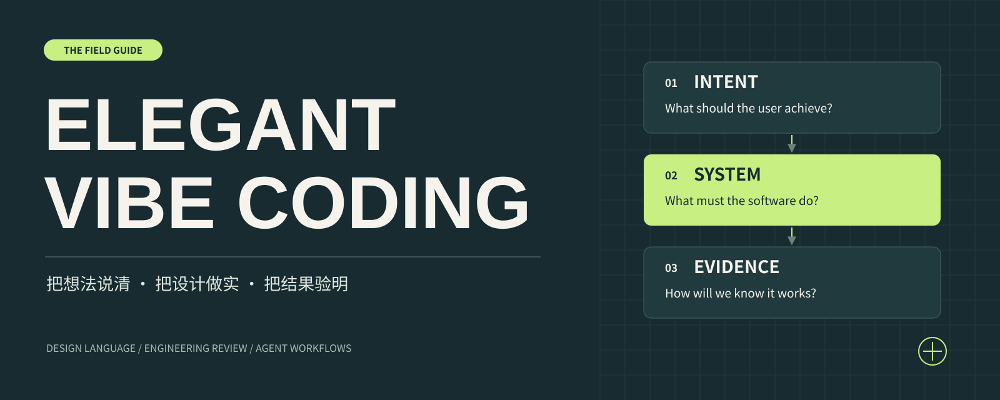
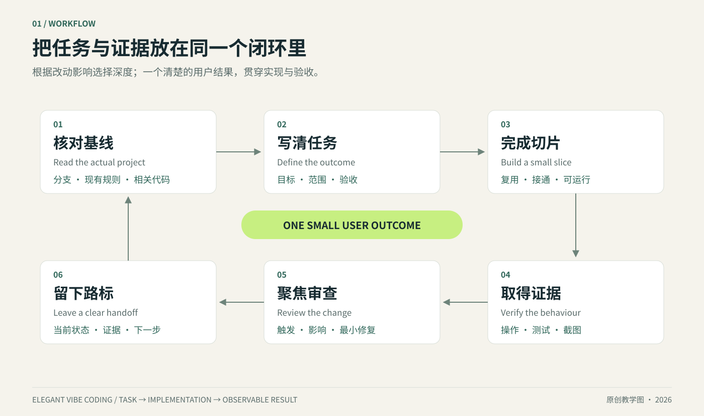

# Elegant Vibe Coding

**一套面向创造者的中文 AI 编码手册：会描述设计，会组织实现，也会判断交付。**

你可以从“让界面更高级”走到“建立清楚的视觉层级、合适的信息密度和完整的交互状态”；从“帮我 review”走到“沿着一条用户请求，核对输入、状态、持久化和失败恢复”。这里把专业术语翻译成能看懂、能复制、能验收的工作语言。

手册适合用 Claude Code、Codex、Cursor、GitHub Copilot 或其他编码助手开发网页、桌面应用与小型产品的人。案例采用虚构的笔记应用、文档管理器、客服问答助手和待办清单；示例数据与界面均为独立教学设计。接入自己的项目时，以当前需求、设计系统和接口约定为准。

**内容更新：2026-10-22 · 各项资料核验日期见对应章节 · 中文 · 持续可维护的 Markdown 源文件**

## 从这里开始

| 你现在需要什么 | 直接打开 |
|---|---|
| 十分钟建立工作方式 | [快速开始](QUICKSTART.md) |
| 给模型一个可以立即执行的小任务 | [任务说明模板](templates/TASK-BRIEF.md) |
| 知道该问什么，以及何时开始行动 | [提问的思想：12 种方法](docs/workflow/05-thinking-and-questioning.md) |
| 把“高级感”说成准确的设计语言 | [视觉语言词典](docs/frontend/01-visual-language.md) |
| 看着截图，给出专业修改意见 | [设计评审与反馈](docs/frontend/04-design-critique.md) |
| 快速确认后端改动是否靠谱 | [5 / 15 / 30 分钟审查](docs/backend/02-review-in-30-minutes.md) |
| 复制指令，立即使用 | [提示词配方](docs/workflow/02-prompt-recipes.md) |
| 查一个英文词、一个命令 | [术语入口](GLOSSARY.md) · [工具与命令](docs/workflow/03-tools-and-commands.md) |
| 看到完整功能如何从需求走到验收 | [资料导入实战](docs/cases/02-feature-walkthrough.md) · [从提问到证据](docs/cases/04-question-to-evidence.md) |
| 用浏览器阅读整套内容 | 下载仓库后双击 [离线阅读器](reader/index.html) |
| 调一调主题、密度和状态 | [前端设计实验室](examples/frontend-lab/index.html) |

> GitHub 上的 HTML 链接展示文件源码。下载仓库并双击 HTML 才会打开交互页面。阅读器内置全文、导航和搜索，打开时无需安装依赖；外部参考链接需要联网。

## 这套手册的使用方式

**按问题进入，按证据结束。** 阅读一章、复制一段指令、做一个小改动，再用明确的行为检查结果。专业术语帮助缩短沟通；它们的价值在于让双方指向同一个可观察的现象。

上图是本手册建议的协作闭环：任务与证据始终配对。小修可以直接实现；跨模块、数据迁移和持续任务需要更完整的说明。模型可以承担实现与检查，人负责目标、取舍和最终使用体验。

## 全部章节

### Ⅰ · 前端：把审美变成可执行的决定

| 章节 | 你会获得什么 |
|---|---|
| [01 视觉语言](docs/frontend/01-visual-language.md) | 艺术方向、风格、排版、留白、网格、色彩、层级；中英术语和可复制指令 |
| [02 设计系统](docs/frontend/02-design-system.md) | Design tokens、语义色、组件变体、密度、响应式；资料管理工作台设计规格 |
| [03 交互与可访问性](docs/frontend/03-interaction-accessibility.md) | 加载、空白、错误、成功、长任务、键盘、焦点、对比度与缩放 |
| [04 设计评审](docs/frontend/04-design-critique.md) | 截图反馈、视觉问题定位、设计方向比较、验收语言 |

### Ⅱ · 后端：沿着一条请求理解系统

| 章节 | 你会获得什么 |
|---|---|
| [01 后端地图与词典](docs/backend/01-backend-map.md) | API、IPC、领域、服务、持久化、事务、幂等、并发、日志等术语 |
| [02 快速 review](docs/backend/02-review-in-30-minutes.md) | 时间分级、风险优先、证据格式、漏洞式推理与最小验证 |
| [03 数据、异步与边界](docs/backend/03-data-async-security.md) | SQLite、文件、迁移、取消、重试、流式连接及部署场景差异 |
| [04 智能体运行时审查](docs/backend/04-agent-runtime-review.md) | 请求配置、工具调用、状态恢复、来源、上下文和成本 |

### Ⅲ · 协作：让编码模型持续推进

| 章节 | 你会获得什么 |
|---|---|
| [01 AI 编码工作流](docs/workflow/01-agentic-workflow.md) | 勘察、任务契约、垂直切片、上下文、验证、交接和 Git 交付 |
| [02 提示词配方](docs/workflow/02-prompt-recipes.md) | 可直接粘贴的勘察、实现、修复、设计、审查与交接指令 |
| [03 工具与命令](docs/workflow/03-tools-and-commands.md) | 自然语言、斜杠命令、Shell 的区别；Git、rg、项目脚本与工具差异 |
| [04 资源阅读地图](docs/workflow/04-reading-map.md) | 有代表性的指南仓库、官方资料、适用条件与采用成本 |
| [05 提问的思想](docs/workflow/05-thinking-and-questioning.md) | 12 种方法的不同用途、开发情境、可复制指令、产物与收束条件 |

### Ⅳ · 实战：把几种能力连起来

| 章节 | 你会获得什么 |
|---|---|
| [01 桌面笔记应用](docs/cases/01-notes-app.md) | 如何给一个虚构笔记应用选任务、讲界面、查数据、定验收 |
| [02 一个资料导入功能的完整走查](docs/cases/02-feature-walkthrough.md) | 从模糊请求到设计规格、接口示意、状态机、风险审查和交付记录 |
| [03 模糊表述的精确改写](docs/cases/03-say-it-precisely.md) | “清爽点、现代点、稳一点、快一点”分别怎样转成行动 |
| [04 从提问到证据](docs/cases/04-question-to-evidence.md) | 批量归档与撤销：澄清目标、比较界面、定义契约、实验、恢复和复盘 |

## 随手可用的模板与清单

| 可填写模板 | 适用时机 |
|---|---|
| [TASK-BRIEF](templates/TASK-BRIEF.md) | 每次开始一个可独立交付的任务 |
| [DESIGN-BRIEF](templates/DESIGN-BRIEF.md) | 开始一个页面、组件或视觉改造 |
| [REVIEW-REPORT](templates/REVIEW-REPORT.md) | 对改动给出有证据的审查意见 |
| [ACCEPTANCE](templates/ACCEPTANCE.md) | 把“完成”写成可以观察的行为 |
| [HANDOFF](templates/HANDOFF.md) | 换模型、换机器或结束一段工作 |
| [ADR](templates/ADR.md) | 记录会影响后续工作的技术取舍 |
| [PROJECT-CONTEXT](templates/PROJECT-CONTEXT.md) | 给编码助手一页可靠的项目地图 |
| [QUESTION-CANVAS](templates/QUESTION-CANVAS.md) | 把关键未知变成下一项行动，结论并回现有任务记录 |
| [EXPERIMENT-CARD](templates/EXPERIMENT-CARD.md) | 故障定位、性能比较或原型观察前后记录预测与证据 |

[前端验收清单](checklists/frontend.md) · [后端审查清单](checklists/backend.md) · [交付检查清单](checklists/delivery.md) · [思考与提问清单](checklists/thinking.md) · [原创图解导览](assets/README.md)

## 三条阅读路线

- **今天就要改界面**：快速开始 → 视觉语言 → 设计说明模板 → 交互状态 → 前端清单。
- **今天就要接功能**：任务说明模板 → 后端地图 → 实战走查 → 30 分钟 review → 交付清单。
- **长期维护个人产品**：提问的思想 → AI 编码工作流 → 项目上下文模板 → 资料与异步 → 运行时审查 → 交接与决定记录。

## 原则与取舍

本仓库标题保留大众熟悉的 *vibe coding*。实际方法更接近**有约束、有验证的 AI 协作开发**：用自然语言降低表达门槛，同时保留人对目标、设计和证据的判断。实验可以轻快；数据持久化、安装升级和付费模型调用等环节，需要与其影响相称的检查。

工具越多，维护与理解成本也会增加。起步可以只用一份项目说明、一张任务单、一份验收记录。资源地图中的 Spec Kit、OpenSpec、Superpowers 等各有适用条件，按你的真实瓶颈选用即可。

## 来源、更新与再利用

- 每章列出一手资料，并区分正式标准、工具行为与作者建议；详见 [来源与核验说明](SOURCES.md)。
- 图解、模板、案例为本仓库原创编排。第三方资料以链接和短摘要介绍，权利属于原作者。
- 本次初始化未替仓库所有者设定对外开源许可证；如需对外授权，可由维护者选定许可证后补充。公开可见与开放许可是两项不同的决定。
- 修改指南见 [CONTRIBUTING.md](CONTRIBUTING.md)，变更记录见 [CHANGELOG.md](CHANGELOG.md)。

**把“我想要什么”说具体，把“已经做好”变成证据。**
