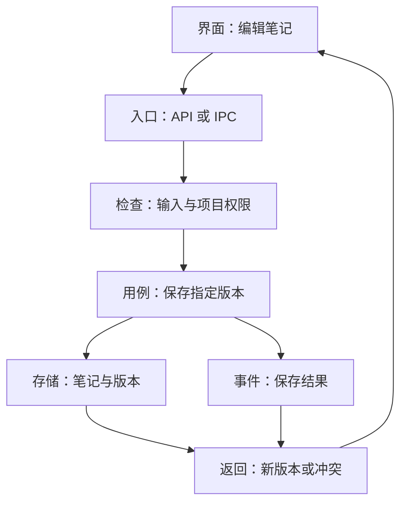

# 后端地图：把“看不见的工作”说清楚

[返回目录](../../README.md) · [快速开始](../../QUICKSTART.md) · [下一章：30 分钟 review](02-review-in-30-minutes.md)

> 阅读方式：先看第一节，再按正在做的功能查词。表格最后一列可以直接发给编码模型。本文的工作站案例均为原创教学场景；文件名、接口和数据结构属于示例设计。

前端呈现一个“保存”按钮，后端要兑现一组承诺：知道保存哪份材料、验证请求、遵守项目边界、处理并发、写入持久存储，并让成功或失败都能被追踪。你掌握这些承诺，就能向模型提出有判断力的问题。

在桌面软件里，后端可以运行在自己的电脑上，例如应用的宿主进程、Node 服务或 Rust 命令处理器。“后端”描述职责，“服务器”描述一种运行方式。把这两者分开，会更容易理解本地资料管理工具。

## 1. 先画职责，再选技术

下面是“保存项目笔记”的教学地图。真实项目可能把几层合并在一个小模块中；边界清楚比文件夹数量更有价值。



把图翻译成一句指令：

```text
请追踪“保存笔记”这一条真实调用链，从界面入口到最终持久化。
列出每一层的实际文件与函数、输入输出、项目范围检查、失败返回。
先解释现有链路，再判断这次需求需要改哪一处。
```

这比“把后端架构优化一下”更容易得到可核查的结果。接口、领域和存储是观察角度；小项目可以维持很少的层。只有变化频率、外部依赖或测试需求出现分歧时，拆分才会带来明确收益。

## 2. 接口与边界：谁在对谁说话

| 术语 | 通俗解释 | 可以直接问模型 |
| --- | --- | --- |
| Backend 后端 | 承担业务处理、存储和外部调用的一侧 | “这项功能的后端职责有哪些？哪些已经存在？” |
| API 应用编程接口 | 软件间约定的调用方式 | “给出接口的输入、输出和错误示例。” |
| IPC 进程间通信 | 同一设备上的不同进程交换消息 | “界面进程通过哪个 IPC 命令访问宿主？宿主验证什么？” |
| Endpoint 端点 | 一个可调用的接口入口 | “这个端点允许的动作和参数范围是什么？” |
| Handler 处理函数 | 接到请求后开始处理的函数 | “处理函数中哪些是协议适配，哪些是业务规则？” |
| Contract 契约 | 调用双方共同遵守的格式与行为 | “成功、失败、超时和重复调用分别怎样返回？” |
| Schema 数据结构约束 | 字段、类型、必填项及取值范围的说明 | “未知字段、空字符串和超长文本怎样处理？” |
| DTO 数据传输对象 | 专门给接口传输的数据形状 | “返回对象会不会顺带暴露内部配置或密钥？” |
| Serialization 序列化 | 把内存对象编码成可传输或保存的数据 | “日期、整数和二进制在传输后还能准确还原吗？” |
| Validation 输入校验 | 检查格式以及业务上是否合理 | “验证发生在哪个可信入口？边界值有何例子？” |
| Authentication 身份认证 | 确认调用者是谁 | “身份从哪个可信会话得来？” |
| Authorization 授权 | 判断此调用者能对哪个资源做什么 | “拿另一个项目的资源 ID 来调用，会发生什么？” |
| Capability 能力权限 | 允许某个主体使用某种动作或资源范围 | “哪个窗口或工具获得了读文件、写文件和执行权限？” |
| Trust boundary 信任边界 | 数据跨越后需要重新审视可信度的位置 | “用户文本、网页、模型输出分别跨过哪些边界？” |

接口校验通常同时包含两层：格式合法，例如文本长度；业务合法，例如目标项目仍然存在。授权还要回答“这一份资源是否属于当前允许的范围”。前端隐藏按钮可以改善体验，最终执行入口仍要校验这些条件。参见 [OWASP 输入校验](https://cheatsheetseries.owasp.org/cheatsheets/Input_Validation_Cheat_Sheet.html)和[授权指南](https://cheatsheetseries.owasp.org/cheatsheets/Authorization_Cheat_Sheet.html)。

采用 Tauri 的项目可以用 capability 限定窗口或 WebView 可使用的权限；多个 capability 的组合也需要一起检查。应用自己的自定义命令还应核对实际注册与权限接线。配置名称存在，并不足以说明每个业务操作都已经受约束。参见 [Tauri Capabilities](https://v2.tauri.app/security/capabilities/)。

## 3. 业务与结构：规则放在哪里

| 术语 | 通俗解释 | 可以直接问模型 |
| --- | --- | --- |
| Domain 领域 | 产品处理的核心概念与规则 | “这里的项目、材料和任务各有什么稳定身份？” |
| Entity 实体 | 具有持续身份、会变化的对象 | “材料更新后，材料 ID 与版本 ID 如何区分？” |
| Value object 值对象 | 用内容表达意义的一组值 | “这个范围、金额或坐标适合用一个整体值表达吗？” |
| Use case 用例 | 一次完整的用户目标 | “从导入材料到可检索，哪一步算完成？” |
| Service 服务 | 承担一组相关业务操作的模块 | “这个服务的职责能用一句话说明吗？” |
| Repository 存储访问层 | 将业务需要翻译成数据读写 | “换一个存储实现时，业务规则要改多少？” |
| Adapter 适配器 | 将某个外部系统转换为内部统一接口 | “供应商的特殊字段是否被收在适配器里？” |
| Dependency injection 依赖注入 | 从外部传入依赖，便于替换与验证 | “测试可以传入假时钟、假存储或假模型吗？” |
| Invariant 不变量 | 任何合法状态都应满足的规则 | “一份成果必须关联一个项目，这条规则在哪里保证？” |
| State machine 状态机 | 明确对象可以处于什么状态、如何变化 | “已完成任务再次收到取消请求会怎样返回？” |
| Side effect 副作用 | 对外部世界产生的变化 | “哪些操作会写盘、扣费、发消息或调用工具？” |
| Coupling 耦合 | 一个模块变化时牵动另一个的程度 | “只换模型供应商，为何要改界面和数据库？” |
| Cohesion 内聚 | 一个模块中的职责有多相关 | “这个文件里哪些代码共同完成同一件事？” |
| Separation of concerns 关注点分离 | 按不同变化原因组织职责 | “业务规则、UI 文案和网络协议可否各自修改？” |

“服务”“仓储”“适配器”是常见组织方式，具体命名依团队而定。让模型指出现有代码中的对应位置，比要求它套入固定文件夹模板更实用。新增一层抽象时，让它写清楚：现在隔离了什么变化，减少了什么重复，引入了多少新理解成本。

**针对资料管理工具的表达示例：**

```text
请把“导入材料”定义为一个完整用例：取得内容、记录来源、保存原件、
建立索引任务、给出可追踪结果。先复用仓库已有实现。
请区分原件保存成功与索引可用两个状态，并说明重开应用后的恢复行为。
```

## 4. 数据与一致性：关机后还剩下什么

| 术语 | 通俗解释 | 可以直接问模型 |
| --- | --- | --- |
| Persistence 持久化 | 把需要保留的信息写入持久存储 | “进程重启后，哪些数据还能恢复？” |
| Source of truth 权威数据源 | 出现冲突时用来判断事实的数据 | “数据库、文件、缓存之间，谁负责哪项事实？” |
| Transaction 事务 | 把一组数据库操作作为一个提交单元 | “中途失败时，哪些写入会一起撤销？” |
| Atomicity 原子性 | 一个操作单元整体完成或整体撤销 | “任务记录与队列记录会出现只写了一半吗？” |
| Constraint 约束 | 由存储层落实的数据规则 | “唯一性和引用关系是否进入数据库约束？” |
| Primary key 主键 | 一行记录的稳定标识 | “重命名之后对象身份仍然稳定吗？” |
| Foreign key 外键 | 引用其他记录的关系约束 | “删除项目后，材料记录按什么策略处理？” |
| Unique constraint 唯一约束 | 限制指定字段组合重复 | “同时导入同一个版本，存储层如何裁定重复？” |
| Migration 数据迁移 | 让既有数据适应新的结构 | “旧数据升级后如何验证？中断后如何继续？” |
| Index 索引 | 帮助按条件快速找到记录的结构 | “这个常用查询有何查询计划和实际耗时？” |
| Cache 缓存 | 为提速保存的可再取得数据 | “缓存过期或丢失后，系统从哪里重建？” |
| WAL 预写日志 | SQLite 的一种日志与并发运行方式 | “日志增长、检查点与备份如何协调？” |
| Checkpoint 检查点 | 某些系统中的可恢复位置；SQLite 中指归并 WAL 内容的过程 | “这里说的检查点具体属于数据库还是任务？” |
| Optimistic concurrency 乐观并发控制 | 提交时检查自己编辑的版本是否仍然有效 | “两个窗口同时保存，如何识别旧版本覆盖？” |
| Lost update 更新丢失 | 后一次写入覆盖了另一人的有效修改 | “旧页面保存时，会提示冲突还是静默覆盖？” |
| Idempotency 幂等性 | 同一意图重复执行，预期业务效果保持一致 | “重试怎样复用操作身份？第二次会返回什么？” |
| Durability 持久性 | 已确认提交的数据经故障后仍可保留的性质 | “成功响应对应哪个真正落盘点？目标故障范围是什么？” |

SQLite 可以同时存在多个读事务，同一时刻只有一个写事务。WAL 改善读写并行，仍保留这一写入约束；因此应缩短持有写事务的时间，把耗时网络调用放在清晰的业务流程中。详见 [SQLite 事务](https://sqlite.org/lang_transaction.html)与 [WAL](https://sqlite.org/wal.html)。

“持久化完成”也要说明故障模型：应用崩溃、操作系统崩溃、断电、磁盘损坏，对应的保障范围不同。实际承诺取决于数据库设置、文件系统和备份恢复流程。手册中的检查问题用于让这些假设显形。

## 5. 异步与可靠性：等待时发生了什么

| 术语 | 通俗解释 | 可以直接问模型 |
| --- | --- | --- |
| Async 异步 | 工作尚未完成时，调用方可以先做别的事 | “界面显示的状态对应哪个真实执行阶段？” |
| Concurrency 并发 | 多件工作在时间上交错推进 | “两个任务争用同一文件或记录时怎样协调？” |
| Parallelism 并行 | 多件工作在不同执行资源上同时运行 | “这项加速受 CPU、网络还是数据库写入限制？” |
| Race condition 竞态条件 | 结果受不可控执行先后影响 | “交换两个回调顺序，结果仍然正确吗？” |
| Queue 队列 | 把待执行工作排队并管理领取 | “队列保存在哪里？重启后如何识别未完成任务？” |
| Worker 执行器 | 从队列取得工作并执行的单元 | “同一任务如何保证只有一个有效执行者？” |
| Lease 租约 | 一段时间内的临时领取权 | “执行者失联后谁能接手？旧执行者恢复会怎样？” |
| Timeout 超时 | 超过约定等待时间便转入相应处理 | “超时代表失败，还是结果暂时未知？” |
| Cancellation 取消 | 将终止意图传递给执行链 | “取消请求到达后，已经提交的副作用怎样说明？” |
| Retry 重试 | 对特定可恢复失败再次尝试 | “只重试哪类失败？间隔、次数和总时长上限是多少？” |
| Exponential backoff 指数退避 | 让连续重试的等待间隔逐步增长 | “多任务一起重试时，有没有随机抖动？” |
| Backpressure 背压 | 下游忙不过来时，向上游限制生产速度 | “消息来得更快时，缓冲区上限与处理策略是什么？” |
| Circuit breaker 熔断 | 持续失败时暂缓访问依赖 | “在哪种故障规模下，这个机制比简单限流更有价值？” |
| Rate limit 速率限制 | 限制单位时间内的调用量 | “本地并发与供应商限额怎样配合？” |
| Graceful shutdown 优雅停止 | 有序停止接新工作并收尾现有工作 | “关闭应用时哪些任务保存进度，哪些直接停止？” |
| Recovery 恢复 | 根据持久记录重建可信运行状态 | “显示恢复成功时，哪些任务已核对外部结果？” |

HTTP 对幂等方法有专门定义，业务上的“生成一次报告”还需要自己的操作身份与落盘策略。尤其当请求已经发出而回复丢失时，结果处于未知状态；是否重试应结合外部服务的幂等能力和查询能力。参见 [RFC 9110，§9.2.2](https://www.rfc-editor.org/rfc/rfc9110.html#section-9.2.2)。

## 6. 观测与交付：出了问题能找到哪一步

| 术语 | 通俗解释 | 可以直接问模型 |
| --- | --- | --- |
| Log 日志 | 某个时刻发生了什么的记录 | “凭这条日志能定位任务、阶段和错误类别吗？” |
| Metric 指标 | 用数值持续观察行为 | “任务耗时、失败率、队列长度分别从哪里统计？” |
| Trace 调用追踪 | 把一次操作跨模块的过程串起来 | “一次导入从入口到模型再到落盘，怎样关联？” |
| Correlation ID 关联标识 | 把相关事件归到同一次工作 | “UI 错误编号能找到对应后端记录吗？” |
| Observability 可观测性 | 从系统输出推断内部状态的能力 | “用户说卡住了，需要哪些证据区分原因？” |
| Structured logging 结构化日志 | 用稳定字段记录事件 | “可以按 runId、阶段和错误类型查询吗？” |
| Redaction 脱敏 | 在日志等输出中隐藏敏感字段 | “Authorization、API key 和全文材料如何处理？” |
| Unit test 单元测试 | 验证一个小职责的行为 | “这条测试保护哪项业务规则？” |
| Integration test 集成测试 | 验证真实模块之间的配合 | “有使用真实数据库而非全套 mock 的关键路径吗？” |
| Regression test 回归测试 | 让已修复问题再次出现时被发现 | “把修复撤销，这条测试是否会失败？” |
| Contract test 契约测试 | 检查调用双方是否遵守约定 | “实际事件字段与消费者预期是否一致？” |
| Migration test 迁移测试 | 用旧数据验证升级行为 | “测试从哪个旧 schema 开始，保留了哪些数据？” |
| Rollback 回滚 | 返回先前可用状态或撤销未提交操作 | “代码回退后，新版数据还能被旧版理解吗？” |
| Feature flag 功能开关 | 控制某条新行为是否启用 | “关掉新行为后，旧数据和任务怎样继续？” |

日志、指标和调用追踪各有侧重，可以逐步采用。小型本地工具首先需要能关联一次运行的结构化日志；当问题复杂度增长时，再增加相应观测设施。这个取舍是本手册的实践建议。信号类别见 [OpenTelemetry Signals](https://opentelemetry.io/docs/concepts/signals/)；敏感信息记录原则见 [OWASP Logging](https://cheatsheetseries.owasp.org/cheatsheets/Logging_Cheat_Sheet.html)。

## 7. 把术语变成一份任务说明

以下指令可替换成任何“修改用户数据”的需求：

```text
目标：让用户修改项目笔记后，保存得到明确结果，重启后可恢复。

请先核对现有入口、数据结构、存储模块和测试命令。
实现范围：复用已有模块，只修改本次功能需要的最小范围。

行为契约：
1. 参数在可信入口校验；项目范围来自已验证上下文。
2. 保存携带期望版本。版本冲突时返回可处理的冲突结果。
3. 只有持久化成功才返回成功；失败保留用户草稿。
4. 日志记录关联 ID、耗时和错误类别，正文按项目规则处理。
5. 用正常保存、旧版本保存、错误项目范围三个场景验证。

交付：实际调用链、改动清单、测试证据、剩余边界。
涉及数据结构变化时，先给出迁移与恢复方案。
```

这里最有用的词是“行为契约”。它把你希望的体验、模型需要写的代码和你最后要检查的结果连在一起。后续[快速 review](02-review-in-30-minutes.md)就沿这些承诺寻找证据。

## 来源与适用范围

核对日期：**2026-10-21**。术语表为本手册原创归纳；不同项目可能使用不同命名。以下文档支持具体机制与边界：

1. [OWASP — Input Validation](https://cheatsheetseries.owasp.org/cheatsheets/Input_Validation_Cheat_Sheet.html)
2. [OWASP — Authorization](https://cheatsheetseries.owasp.org/cheatsheets/Authorization_Cheat_Sheet.html)
3. [Tauri 2 — Capabilities](https://v2.tauri.app/security/capabilities/)
4. [SQLite — Transactions](https://sqlite.org/lang_transaction.html)
5. [SQLite — Write-Ahead Logging](https://sqlite.org/wal.html)
6. [IETF — RFC 9110, HTTP Semantics](https://www.rfc-editor.org/rfc/rfc9110.html)
7. [OpenTelemetry — Signals](https://opentelemetry.io/docs/concepts/signals/)
8. [OWASP — Logging](https://cheatsheetseries.owasp.org/cheatsheets/Logging_Cheat_Sheet.html)
