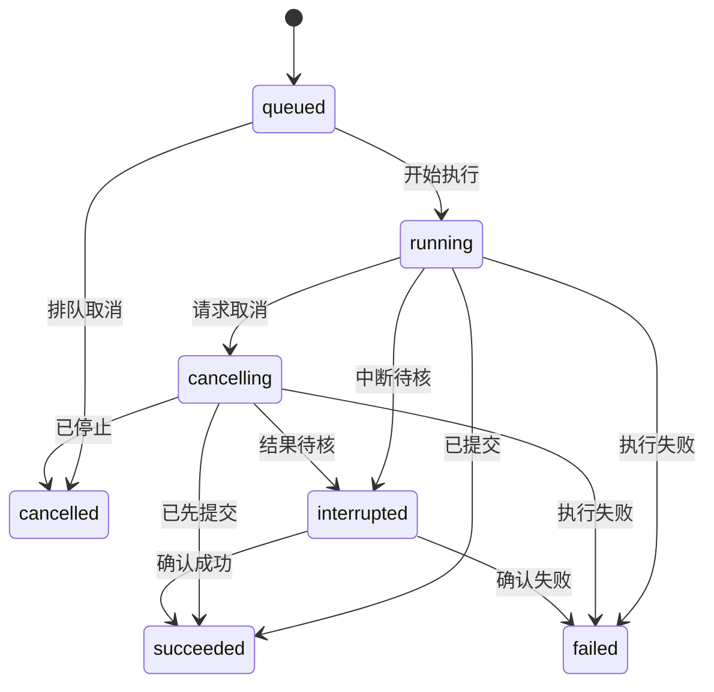

# 数据、长任务与安全：可靠性最容易漏掉的地方

[返回目录](../../README.md) · [快速开始](../../QUICKSTART.md) · [快速 review](02-review-in-30-minutes.md) · [模型运行时](04-agent-runtime-review.md)

> 按需使用：保存或迁移数据时读第 2–3 节；任务卡住、取消、重试时读第 4–6 节；接入文件、外部模型或公网入口时读第 7–8 节。每节给出审查问题和一条可复制指令。

可靠性来自可解释的承诺：数据何时保存，任务何时完成，重复操作发生什么，出错后用户如何继续。先把这些行为做准确，再按产品规模选择机制。

## 1. 根据部署场景选择检查深度

| 场景 | 优先关注 | 出现对应需求时再增加 |
| --- | --- | --- |
| 个人离线工具 | 文件范围、数据恢复、输入大小、错误反馈 | 插件隔离、复杂权限策略 |
| 本地工具调用云端模型 | 上述项目，加凭据、发送范围、取消与费用 | 多用户配额、团队审计 |
| 本机有 HTTP 服务 | 监听地址、调用认证或会话策略、来源检查、请求限制 | 反向代理、多实例部署 |
| 团队共享或公网应用 | 身份、租户隔离、授权、暴露面、限流和监测 | 高可用、复杂灾备、合规流程 |

这张表是风险排序建议。部署在本机仍需考虑浏览器内容、导入文件、插件和本机其他进程；个人工具可以保持简单，检查应跟随实际入口。审查范围由目标应用的部署方式、实际入口和数据影响确定。

## 2. SQLite：读写简单，恢复需要认真

### 2.1 四件事情最值得核对

**第一，事务包住一组必须共同成功的数据库写入。** 例如“创建任务”和“写入待处理记录”如果属于同一数据库，可以在同一事务内完成。外部模型响应、文件复制和数据库事务属于不同资源，整体一致性需要额外安排。

**第二，写事务保持短小。** SQLite 同时只允许一个写事务。先取得必要数据，结束数据库事务，再等待模型或网络；拿到结果后开启一个短事务校验当前状态并提交。精确策略取决于业务竞争条件。参见 [SQLite Transactions](https://sqlite.org/lang_transaction.html)。

**第三，WAL 让读写更容易并行，但要照顾检查点和文件布局。** 活跃数据可能仍在 `-wal` 中。备份运行中的库时，应使用受支持的数据库备份方式；随手复制一个 `.db` 文件无法表达一个完整、稳定的在线快照。WAL 的共享内存设计也要求参与进程在同一主机，网络文件系统并非合适的默认选项。参见 [SQLite WAL](https://sqlite.org/wal.html)。

**第四，显式验证连接级设置。** 外键约束是否启用要由应用初始化设置并核对，避免依赖构建或驱动的默认行为。设置应在合适的连接阶段完成；`PRAGMA foreign_keys` 在已开始的事务内切换没有效果。参见 [SQLite PRAGMA foreign_keys](https://sqlite.org/pragma.html#pragma_foreign_keys)。

### 2.2 把“备份成功”写成可验证结果

一次备份至少说明：备份的数据库和附件范围、使用的工具、版本或时间点、完整性检查结果，以及如何在独立位置恢复。SQLite 提供 Online Backup API，也提供 `VACUUM INTO` 等方式；应根据当前驱动和数据库版本选择。参见 [SQLite Backup API](https://sqlite.org/backup.html)。

在**明确的测试副本**上，可以用 SQLite CLI 进行只读检查：

```bash
sqlite3 -readonly /absolute/path/to/test-copy.db "PRAGMA integrity_check; PRAGMA foreign_key_check;"
```

前提是已安装 CLI 且路径确实指向测试副本。完整性检查关注数据库结构，外键检查关注关系约束；业务上的“导入材料数与原件数是否一致”仍要另查。大库扫描有成本，应按待解决问题选用。相关检查见 [SQLite PRAGMA](https://sqlite.org/pragma.html#pragma_integrity_check)。

```text
请说明当前 SQLite 连接如何初始化、哪些业务写入需要同一事务，
以及备份是否覆盖运行期间的已提交数据和关联附件。
先读现有实现；选择一个真实风险验证：进程中断、旧数据恢复或锁竞争。
给出恢复到独立测试位置的步骤与验收条件。
```

### 2.3 数据库约束如何帮助你

“先 SELECT 看有没有，再 INSERT”之间可能插入另一条并发请求。对于必须唯一的业务身份，优先让数据库唯一约束裁定，再把冲突转换成明确结果。

例如教学场景中的 `(project_id, import_key)` 唯一约束可以表达“同一项目内，这个导入意图只登记一次”。这和“内容 hash 相同就永远去重”不同：两个材料可能内容相同但来源不同，是否合并属于产品规则。SQLite 的唯一索引规则见 [CREATE INDEX](https://sqlite.org/lang_createindex.html)。

## 3. 数据库、文件与迁移：承认它们有各自的提交点

### 3.1 文件加数据库的一种简单方案

以下为可选实现思路，用于说明恢复原则：

1. 为导入分配稳定操作 ID，登记 `pending` 状态。
2. 把原件写入受控暂存位置，完成大小与内容校验。
3. 将文件放入最终位置，更新数据库为 `ready`。
4. 启动时检查长时间停在 `pending` 的记录，核对实际文件并继续或标记失败。

关键问题是每一步中断后都有明确线索。数据库可以记录“文件已准备好”，文件可以被重读和校验，恢复器可以继续已有操作。`rename` 的原子性、跨卷行为和持久性要按目标平台与文件系统核对；“使用了 rename”这一事实本身不足以说明断电后整个组合操作都成功。Node 文件操作语义见 [File system API](https://nodejs.org/api/fs.html)。

| 中断点 | 恢复时应能观察到 | 可采取的动作 |
| --- | --- | --- |
| 登记后、文件写入前 | `pending` 记录，缺少文件 | 继续或给出可重试失败 |
| 暂存文件写入中 | 暂存文件与未完成记录 | 验证完整性后继续，或安全清理暂存 |
| 最终文件已就位、记录尚未更新 | 文件存在，记录仍待完成 | 校验身份和内容后补齐登记 |
| 记录为 `ready`、文件缺失 | 状态与事实冲突 | 明确显示异常并启动恢复流程 |

### 3.2 迁移先回答“旧数据怎么办”

| 需要说明 | 好的交付内容 |
| --- | --- |
| 起点 | 当前 schema 版本以及支持升级的旧版本 |
| 变化 | 新字段含义、默认值、约束与索引 |
| 存量处理 | 空值、重复值、旧编码和异常数据怎样转换 |
| 中断恢复 | 事务、迁移进度或重入策略 |
| 成功验收 | 旧数据数量、关键字段与应用读取结果 |
| 撤回方案 | 旧版本能否读取新 schema；必要时使用已验证备份恢复 |

代码回滚与数据回滚分开评估。新增字段可能兼容旧程序，字段重解释或删除则可能要求恢复数据。迁移脚本应与应用版本一起审查，特别关注旧数据是否真的走过升级路径。SQLite 修改表的实际能力与限制见 [ALTER TABLE](https://sqlite.org/lang_altertable.html)。

```text
这次需要修改持久数据结构。请先列出旧 schema、目标 schema、
存量转换规则和旧版程序的兼容情况，再实现最小迁移。
用一份包含历史数据的测试库验证；给出迁移前后关键记录对比，
以及中断或撤回时如何恢复到可用状态。
```

## 4. 取消：用户的意图需要传到真正执行的位置

“已收到取消”“执行已停止”“副作用已经提交”是三条不同事实。UI 最好准确显示它们，让用户知道哪些结果已经存在、哪些工作已经停止。

以下状态图是一种教学示意；实际项目可以沿用既有状态名：



这个图有三个重点：

- **取消会沿链路传播。** UI、任务调度、网络请求、工具执行需要共享相应取消信号。Node 的 `AbortController` 是为支持它的 API 传递取消意图的机制；各依赖仍需实际接入。[Node.js AbortController](https://nodejs.org/api/globals.html#class-abortcontroller)
- **已提交的副作用有自己的事实。** 已写好的文件、已创建的远程任务和已经发生的调用费用，需要记录并呈现。补偿或清理是另一项操作，应按业务定义执行。
- **终态转换有明确裁定。** 若任务已经成功提交，再来的取消请求可以返回“已完成，取消未生效”。重放一条旧取消事件时，也应保留这个完成事实。

本地停止读取流后，远端模型可能已经生成了内容，甚至已经完成请求；当前 SDK、供应商和传输层是否真正终止远端计算，需要分别核实。对用户描述“本地请求已停止，费用待供应商记录确认”会更准确。

```text
请追踪取消按钮到实际网络请求和工具执行的完整链路。
核对三种情况：排队时取消、执行中取消、结果已提交后才收到取消。
使用已有状态模型，让返回值准确说明是否停止、已有何种副作用，
以及重开应用后如何恢复这个结论。
```

## 5. 重试：先辨认“失败”还是“结果未知”

| 观察到的情况 | 典型处理思路 | 核查重点 |
| --- | --- | --- |
| 参数或业务规则无效 | 返回可修正错误 | 重复同一输入是否毫无收益 |
| 身份或权限有误 | 引导修正身份与配置 | 防止连续无效调用 |
| 限流响应 | 按服务要求等待，受总预算约束 | `Retry-After`、队列和并发 |
| 暂时服务故障 | 对适合重试的操作有限重试 | 动作是否幂等、请求是否已生效 |
| 请求发出后连接断开 | 进入结果未知的核对流程 | 外部 operation ID 与查询接口 |
| 已确认完成但返回丢失 | 复用已记录的完成结果 | 持久化幂等键和结果关联 |

重试配置至少包含尝试次数、总时长、单次超时和退避方式。多任务一起恢复时，可加入随机抖动，减少同时冲击依赖。关键限制放在共同调度点，避免各层 SDK、适配器和任务系统叠加重试，悄悄把一次动作放大成几十次。

HTTP 幂等性针对请求的预期效果。你的业务操作还应说明幂等键由谁创建、范围是什么、保存多久、重复但参数变化怎样处理。发送一个自定义请求头，只有在接收端实际按约定处理时才产生相应保障。参见 [RFC 9110 §9.2.2](https://www.rfc-editor.org/rfc/rfc9110.html#section-9.2.2)。

**教学例：** 用户重试“导入这个文件”可沿用同一操作 ID；用户明确发起第二次独立导入应得到新的操作 ID。UI 的一次点击、网络的一次发送、业务的一次意图，是三个需要区分的粒度。

```text
请列出当前调用链每一层的重试行为，包括 SDK 默认重试。
按“明确未执行、可能已执行、已确认完成”分类处理失败。
对重复调用验证最终业务效果与费用风险，并给出总尝试预算。
```

## 6. SSE、WebSocket 与事件恢复

| 选择 | 适合的用途 | 审查重点 |
| --- | --- | --- |
| 普通 HTTP 请求 | 有明确起点与结果的操作 | 超时、错误分类、幂等性 |
| SSE / EventSource | 服务器持续向界面推送状态或文本 | 事件 ID、重连、积压与终态 |
| WebSocket | 双向持续通信 | 心跳、断线、缓冲、关联与重放 |
| 桌面 IPC / channel | 本地界面与宿主通信 | 生命周期、窗口关闭、可调用范围 |

SSE 的 `id` 和 `retry` 字段能配合浏览器的 `EventSource` 重连行为；服务端仍需有事件记录、游标处理和回放策略，才能恢复业务进度。使用 `fetch` 自己读取 SSE 格式时，也要自己实现相应连接管理。详见 [MDN SSE](https://developer.mozilla.org/en-US/docs/Web/API/Server-sent_events/Using_server-sent_events)。

浏览器传统 `WebSocket` 接口没有自动背压机制。生产速度高于处理速度时，要安排缓冲上限、批量更新、必要的丢弃或暂停策略。详见 [MDN WebSocket](https://developer.mozilla.org/en-US/docs/Web/API/WebSockets_API)。

一种便于核查的事件形状：

```json
{
  "runId": "run-example",
  "eventId": 42,
  "type": "artifact.ready",
  "occurredAt": "2026-10-21T08:00:00Z",
  "payload": { "artifactId": "artifact-example", "revision": 3 }
}
```

这里的数字是教学数据。真正要约定的是事件 ID 在什么范围内单调或唯一、哪些事件需要持久化、消费者如何去重、游标过旧时怎样回到快照。文字增量可以按块合并显示，最终成果则可以通过稳定 ID 再次读取。

## 7. 安全 review：从真实入口出发

| 边界 | 核查问题 | 优先方案 |
| --- | --- | --- |
| SQL 参数 | 用户输入怎样进入查询？ | 参数绑定；动态表名与排序字段使用明确映射 |
| 文件访问 | 请求如何选择允许读写的文件？ | 受控资源 ID、规范路径与真实范围检查 |
| 命令执行 | 参数是否被当成 shell 代码？ | 固定可执行程序及参数数组，尽量直接调用 |
| 凭据 | API key 会出现在哪些持久与可见位置？ | 采用项目选定的安全存储，日志脱敏 |
| 浏览器或 WebView | 外来页面能否调用本地能力？ | 按来源与用途限制宿主能力 |
| 模型输出 | 文本是否直接变成代码、SQL、HTML或指令？ | 按目标类型验证并在执行点检查 |
| 本地 HTTP | 谁可以向服务发请求？ | 明确监听范围、会话策略和可信来源 |
| 外部 URL | 任意地址是否能让服务访问内网？ | 按业务允许的协议与目的地限制访问 |

参数化 SQL 用来分离查询结构与数据；对于无法参数化的标识符，要使用受控选项。文件范围检查应考虑绝对路径、`..`、符号链接或 Windows junction、大小写与检查后变化；单靠字符串前缀容易把相邻目录误认为授权目录。具体机制参见 [OWASP SQL Injection](https://cheatsheetseries.owasp.org/cheatsheets/SQL_Injection_Prevention_Cheat_Sheet.html)与 [Path Traversal](https://community.owasp.org/attacks/Path_Traversal)。

命令运行要区分“命令字符串”与“参数”。在 Node 中，`execFile` 等接口可以直接指定程序与参数，避免无意经过 shell；平台特例、脚本类型和显式 `shell` 选项仍要核对。参见 [Node.js child_process](https://nodejs.org/api/child_process.html)。

对于本地服务，CORS 主要约束浏览器读取跨源响应，并非所有调用方的身份验证机制。调用认证、来源限制和监听地址应根据实际暴露面设计。参见 [MDN CORS](https://developer.mozilla.org/en-US/docs/Web/HTTP/Guides/CORS)。

支持用户指定 URL 的工具，应考虑重定向后的目的地，以及解析出的实际网络地址。按业务需要决定是否允许本机或内网目标，并将这项选择落实到请求执行处。参见 [OWASP SSRF Prevention](https://cheatsheetseries.owasp.org/cheatsheets/Server_Side_Request_Forgery_Prevention_Cheat_Sheet.html)。

## 8. 依赖与日志：小改动里的隐藏边界

### 依赖审查的四问

1. 新依赖解决哪一个实际问题，现有依赖是否已有对应能力？
2. 包名、来源、许可和维护状态是否核对？
3. 锁文件为何发生变化，是否包含意外的大范围升级？
4. 安装脚本、构建脚本和运行时权限有何变化？

`npm ci` 按锁文件执行安装，锁文件与 `package.json` 不一致时会报错；它也会重建依赖目录，属于会修改本地环境的命令。审查时先读脚本和变更，再决定安装与验证路径。`npm audit` 提供已知漏洞信息，适合结合实际可达性和使用场景判断；`audit fix --force` 会改变依赖关系，应作为有范围的升级任务处理。参见 [npm ci](https://docs.npmjs.com/cli/v11/commands/npm-ci/)与 [npm audit](https://docs.npmjs.com/cli/v11/commands/npm-audit/)。

### 一条适合本地工具的错误记录

```json
{
  "level": "error",
  "event": "import.failed",
  "runId": "run-example",
  "projectId": "project-example",
  "stage": "persist",
  "code": "DISK_WRITE_FAILED",
  "durationMs": 248,
  "retryable": false
}
```

稳定标识、阶段与错误类别通常足以定位很多问题。正文、完整请求头、令牌和个人文件路径是否记录，要按项目敏感性与调试需求明确处理。错误日志同样应考虑长度限制与日志注入。参见 [OWASP Logging](https://cheatsheetseries.owasp.org/cheatsheets/Logging_Cheat_Sheet.html)。

## 9. 给编码模型的一条整合指令

```text
请只围绕本次改动，检查数据保存、长任务和外部调用的真实风险。
先读现行项目约定，按个人本地/团队/公网部署选择检查深度。

请回答：
1. 成功在哪个提交点成立？失败或中断后如何恢复？
2. 重试是否放大副作用？结果未知时怎样核对？
3. 取消如何传到执行处？已提交的效果怎样呈现？
4. 输入、文件、凭据和工具输出跨越哪些实际边界？

只对有证据的风险提出修复。复用已有架构与验证工具，
选最能发现本次错误的少量测试，记录结果及适用范围。
```

## 来源与适用范围

核对日期：**2026-10-21**。恢复步骤、检查表与示例状态为原创设计建议，应适配目标平台和当前项目契约。

1. [SQLite — Transactions](https://sqlite.org/lang_transaction.html)
2. [SQLite — WAL](https://sqlite.org/wal.html)
3. [SQLite — Backup](https://sqlite.org/backup.html)
4. [SQLite — PRAGMA](https://sqlite.org/pragma.html)
5. [SQLite — CREATE INDEX](https://sqlite.org/lang_createindex.html)
6. [SQLite — ALTER TABLE](https://sqlite.org/lang_altertable.html)
7. [Node.js — File system](https://nodejs.org/api/fs.html)
8. [Node.js — AbortController](https://nodejs.org/api/globals.html#class-abortcontroller)
9. [IETF — RFC 9110](https://www.rfc-editor.org/rfc/rfc9110.html)
10. [MDN — Server-sent events](https://developer.mozilla.org/en-US/docs/Web/API/Server-sent_events/Using_server-sent_events)
11. [MDN — WebSocket API](https://developer.mozilla.org/en-US/docs/Web/API/WebSockets_API)
12. [OWASP — SQL Injection Prevention](https://cheatsheetseries.owasp.org/cheatsheets/SQL_Injection_Prevention_Cheat_Sheet.html)
13. [OWASP — Path Traversal](https://community.owasp.org/attacks/Path_Traversal)
14. [Node.js — Child processes](https://nodejs.org/api/child_process.html)
15. [MDN — CORS](https://developer.mozilla.org/en-US/docs/Web/HTTP/Guides/CORS)
16. [npm — ci](https://docs.npmjs.com/cli/v11/commands/npm-ci/)
17. [npm — audit](https://docs.npmjs.com/cli/v11/commands/npm-audit/)
18. [OWASP — Logging](https://cheatsheetseries.owasp.org/cheatsheets/Logging_Cheat_Sheet.html)
19. [OWASP — SSRF Prevention](https://cheatsheetseries.owasp.org/cheatsheets/Server_Side_Request_Forgery_Prevention_Cheat_Sheet.html)
