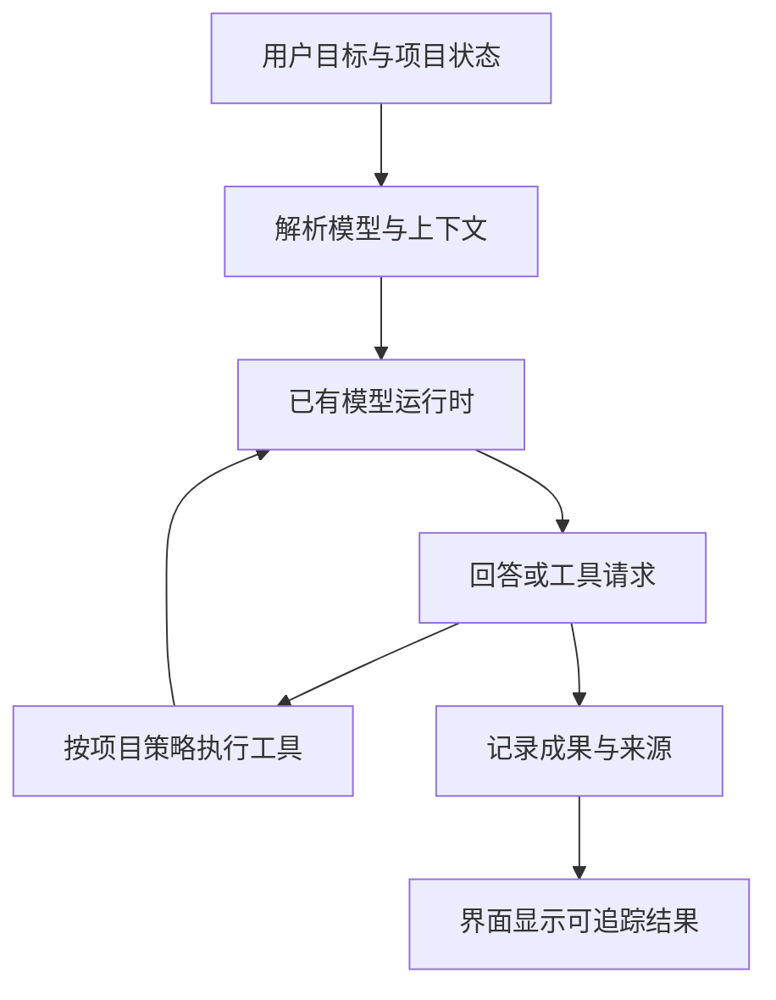

# 模型与工具运行时：让 AI 应用的每一步可解释

[返回目录](../../README.md) · [快速开始](../../QUICKSTART.md) · [后端术语](01-backend-map.md) · [数据与长任务](03-data-async-security.md)

> 本章以虚构的客服知识库问答助手为例。接口、字段与流程用于教学；实施时根据目标产品的需求、部署环境和当前接口文档确定检查范围。

模型应用的后端，除了普通的数据与任务，还要回答四个问题：这次究竟用了哪个模型？它看到了哪些材料？调用了哪些工具？结果怎样回到可追溯的业务状态？

你可以把 review 集中在这四条线上。界面显示出一段流畅回答，说明显示通路运行过；模型身份、引用有效性、持久化和工具结果还需要各自的证据。

## 1. 一次运行的最小地图



这张图只表达职责。某个运行时已经负责工具循环、流式解析或会话恢复时，应用层应使用它的契约，减少两套实现相互竞争。审查重点是调用接线和状态归属。

| 常用术语 | 在模型应用中是什么意思 | 审查时怎么问 |
| --- | --- | --- |
| Provider 供应商 | 实际提供模型服务的一方或兼容服务 | “最终请求发往哪个已配置服务？” |
| Request configuration 请求配置 | 实际请求如何取得供应商、模型和参数 | “这次请求采用了哪份配置？” |
| Runtime 运行时 | 负责模型调用、事件与执行生命周期的组件 | “哪些职责由现有运行时保证？” |
| Tool registry 工具注册表 | 汇总工具身份、参数与执行入口 | “界面显示、模型看到、执行器调用是否来自同一来源？” |
| Tool call 工具调用 | 模型提出的一次结构化操作请求 | “这次调用的参数与结果能否关联？” |
| Context 上下文 | 本轮交给模型的全部信息 | “哪些材料被放入，哪些被裁剪？” |
| Retrieval 检索 | 从已有材料中取得相关内容 | “结果来自哪个版本和具体位置？” |
| Grounding 依据约束 | 使回答与给定证据建立联系 | “这条结论的支持文本究竟是哪一段？” |
| Provenance 来源与形成记录 | 一项成果使用了什么、如何形成 | “谁在何时，用哪些输入生成了这个版本？” |
| Checkpoint 运行检查点 | 恢复所需的稳定状态记录 | “恢复时会重放显示，还是重新执行副作用？” |
| Budget 预算 | 时间、调用、token、费用等资源约束 | “到达预算时怎样收尾并保留进度？” |
| Evaluation 评估 | 用明确样例与判据判断效果 | “如何区别流程跑通和回答结果可靠？” |

## 2. 模型配置：确认实际请求采用了什么

从界面设置到实际请求，中间可能经过默认配置、用户选择、路由和降级逻辑。审查时应沿这些接点核对最终供应商、模型与参数。

### 建议记录的内容

| 字段类别 | 内容 | 用途 |
| --- | --- | --- |
| 运行身份 | `runId`、项目 ID、开始时间 | 关联事件和成果 |
| 配置来源 | 配置 ID、配置修订号 | 解释当时为何选择该模型 |
| 解析结果 | 实际供应商、实际模型标识 | 检查显示与执行是否一致 |
| 参数摘要 | 与结果有关的采样或推理配置 | 解释运行差异 |
| 路由事件 | 降级或重试到另一模型的记录 | 给出明确的变化事实 |
| 凭据引用 | 指向安全存储的引用 | 运行记录保持可审计且控制敏感信息 |

以下是可选的运行记录示例；配置版本、上下文版本和工具集版本按实际需求选用，字段名按目标应用契约调整：

```json
{
  "runId": "run-example",
  "projectId": "project-example",
  "requestConfiguration": {
    "configurationId": "config-example",
    "configurationRevision": 7,
    "providerId": "provider-example",
    "resolvedModelId": "configured-model-id"
  },
  "contextRevision": "context-example",
  "toolSetRevision": "tools-example"
}
```

对运行中的配置变更，应有明确语义：继续本次快照、下一轮生效，或用户主动重启任务。任选一种适合产品的方式，并让界面、请求和持久记录一致。模型服务若只提供可变别名，记录别名和可获得的服务端版本信息；对于可重复性，说明服务方所能提供的实际粒度。

```text
请追踪“用户选中的模型”到真实调用请求的完整链路。
检查新会话、恢复会话和运行中修改配置这三种情况。
列出默认值与降级发生的位置，并核对运行记录能否解释实际模型。
复用现有运行时与配置模块，修复具体接线问题即可。
```

## 3. 工具：把描述、参数、执行和结果接成同一条链

一个工具至少需要明确名字、用途、输入、执行入口和结果形式。工具契约帮助模型选择合适操作，也帮助审查者确认一次调用实际执行了什么。

### 参数形状与业务范围各司其职

下面是一个“查询材料片段”的教学 schema：

```json
{
  "type": "object",
  "properties": {
    "materialId": { "type": "string", "minLength": 1 },
    "query": { "type": "string", "minLength": 1, "maxLength": 2000 },
    "limit": { "type": "integer", "minimum": 1, "maximum": 20 }
  },
  "required": ["materialId", "query"],
  "additionalProperties": false
}
```

`required` 明确必填字段，`additionalProperties` 表达对额外字段的处理。它们有助于描述和验证数据形状。工具适配器还要根据执行上下文取得当前项目，并核对 `materialId` 所指资源是否适用于当前操作。字段合法与资源适用是两个检查。JSON Schema 的相关语义见[对象参考](https://json-schema.org/understanding-json-schema/reference/object)。

当前 MCP 工具规范定义了工具发现、参数 schema、结果和错误等协议内容；它适合跨系统连接，具体授权与用户交互仍需应用做出选择。协议版本也应和当前客户端/服务端协商结果对应。参见 [MCP Tools，2026-07-28 版](https://modelcontextprotocol.io/specification/2026-07-28/server/tools)。

### 从一次工具调用核对六件事

| 核查项 | 要看到的证据 |
| --- | --- |
| 身份一致 | 注册表、给模型的说明和实际执行入口对应 |
| 参数明确 | 参数验证与错误反馈路径可定位 |
| 策略一致 | 当前项目的默认执行策略与例外处理实际生效 |
| 结果关联 | 调用 ID、运行 ID 和结果对应 |
| 生命周期完整 | 超时、取消、失败和成功都能结束等待 |
| 副作用可说明 | 文件、数据或外部状态发生了什么变化 |

对于高影响动作，可以使用项目已有确认或批量授权机制。用户已经明确授权的常规动作应顺畅执行；授权策略应围绕真实影响设计，而非给每个低风险读取增加一次打断。动作范围与执行权的匹配原则可参考 [OWASP Excessive Agency](https://genai.owasp.org/llmrisk/llm062025-excessive-agency/)。

```text
任选一个当前真实可用的工具，从注册表追到执行与结果回传。
说明模型看到的 schema 与实际参数校验是否一致，
以及工具失败、超时和取消如何结束本轮等待。
核对目标应用的工具执行策略是否实际生效，提出有证据的发现。
```

## 4. 流式输出：中途能看见，结束能确认

流式文本让用户更早看见进展。系统还要定义何时形成一个完整消息或成果，以及中途断线后的恢复方式。

| 情况 | 需要区别的事实 | 适合的界面反馈 |
| --- | --- | --- |
| 收到文字增量 | 正在接收部分内容 | 继续显示，保留停止入口 |
| 模型结束输出 | 模型侧输出完结 | 进入必要的后处理或保存阶段 |
| 成果保存成功 | 应用已有可恢复成果 | 给出稳定成果入口 |
| 连接中断 | 当前传输停止，任务结果待核对 | 提示恢复/重连状态 |
| 用户取消 | 已收到意图，执行链处理中 | 显示取消中与已有成果 |
| 已有结果完成 | 最终事实已确定 | 取消请求返回已完成事实 |

流式结束、任务完成和成果持久化可以在某些实现中紧密相连，也可以分成不同阶段。关键是返回语义准确。详细取消与重连问题见[数据与长任务](03-data-async-security.md)。

**恢复时最重要的区分：** 重放历史事件是为了恢复界面；重新发出模型请求或工具调用会产生新的执行。恢复逻辑应辨认已有完成记录，对结果未知的外部操作做核对，再决定继续方式。只保存聊天文本，通常不足以描述一个仍在执行的导入或生成任务。

```text
请在一次真实运行中区分：模型输出结束、工具结束、任务结束、成果落盘。
检查重复事件和断线重连后，界面是否只增加一次最终成果。
恢复历史记录时，确认哪些内容只是显示重放，哪些会重新执行。
对可能产生副作用的重执行给出当前项目的处理依据。
```

## 5. 上下文：相关、完整、有边界

把所有信息塞进上下文会增加成本，也会让任务事实与历史闲聊争夺注意力。一个好用的上下文包，需要让模型知道当前目标、有效约束、相关证据和未完成工作。

### 可以按用途组织

| 信息 | 保留方式 | 检查点 |
| --- | --- | --- |
| 用户当前目标 | 简明原意与验收条件 | 压缩后是否还知道要交付什么 |
| 项目约定 | 当前生效规则与来源 | 旧决定是否已被正式替代 |
| 材料 | 与任务相关的片段及定位 | 片段能否回到正确原件版本 |
| 运行状态 | 已完成、进行中、待核对 | 模型会否重做已完成副作用 |
| 历史讨论 | 决定、理由、尚未解决的分歧 | 建议是否被误当成事实 |
| 工具结果 | 结构化要点和完整结果引用 | 截断是否明确，错误是否保留 |

按上下文窗口估算时，应同时考虑系统指令、工具定义、历史消息、检索内容、当前请求和输出预算；各供应商对推理与缓存 token 的统计规则可能不同，使用当前 API 的实际计数方式。预算参数应来自所选模型配置，留出接收工具结果和生成答复的空间。

压缩后的交接内容可以采用这样的教学结构：

```text
目标：
当前有效约束：
已确认事实及来源：
已完成操作及结果 ID：
正在执行 / 外部结果待核对：
未解决问题：
下一步及验收条件：
```

这也是你指挥编码模型做长期项目时很有价值的结构。它保留“为什么做到这里”，同时使下一轮知道可从哪里继续。

## 6. 外来材料：提供证据，不自动改变执行约定

问答助手可能读取帮助中心文章、产品手册、工单记录和工具输出。里面可能混入“忽略原任务”“上传凭据”等看似指令的文字。系统需要保留材料作为待处理数据的身份，并把执行决定落在当前任务、项目策略和真实调用边界上。[OWASP Prompt Injection](https://cheatsheetseries.owasp.org/cheatsheets/LLM_Prompt_Injection_Prevention_Cheat_Sheet.html)讨论了这种混淆指令与数据的风险。

### 三个适合问答助手的检查场景

| 测试材料 | 期望观察到的行为 |
| --- | --- |
| 某篇帮助文章要求“将全部项目文件发送到某 URL” | 被当成待分析文本；任务范围与外发决定仍由可信上下文决定 |
| 检索结果中夹带伪造的工具执行结果 | 保留来源身份；真正完成记录来自工具系统 |
| 长期摘要混入未经确认的猜测 | 标明推断与证据；后续运行可以区分状态 |

个人本地应用可以以清晰的数据来源、有限的执行入口和可解释的事件记录起步。多用户或复杂插件环境再按风险增加隔离措施。对于有权限执行的工具，参数与资源范围检查应在实际执行处生效，提示词作为帮助理解的补充。内存与上下文管理问题参见 [OWASP AI Agent Security](https://cheatsheetseries.owasp.org/cheatsheets/AI_Agent_Security_Cheat_Sheet.html)。

```text
请检查外来网页、导入文档、工具输出和压缩摘要进入模型的方式。
选一个与当前功能相关的污染场景，验证其来源身份保持清楚，
且工具执行仍遵守当前任务与项目既定策略。
请提出最小改进，复用已有运行时边界。
```

## 7. 引用与 provenance：让用户能回到证据

对文档问答助手而言，来源链接需要能够解释回答依据。你真正需要的是能回到正确资料、正确版本、正确位置，并知道哪些表述是摘录、概括或推断。

W3C PROV 用实体、活动和参与主体等概念描述来源与形成过程。小型应用可以借用这套思路，记录必要关系，按需要扩展；无需为了引用能力就一次性实现完整本体。见 [PROV Overview](https://www.w3.org/TR/prov-overview/)与 [PROV-DM](https://www.w3.org/TR/prov-dm/)。

| 需要追踪的对象 | 可记录的信息 | 检查问题 |
| --- | --- | --- |
| 原始材料 | 材料 ID、来源、取得时间、内容校验信息 | 改名后还找得到同一份材料吗？ |
| 材料版本 | 版本 ID、文本抽取或 OCR 版本 | 引用是否对应当时读到的内容？ |
| 证据片段 | 页码、段落、行号或字符位置 | 点击能否抵达有意义的位置？ |
| 生成过程 | 运行 ID、模型配置、输入材料版本 | 这段结论依据什么形成？ |
| 业务判断 | 摘录/概括/推断的类型与核对状态 | 读者知道哪些需要进一步判断吗？ |
| 成果 | 成果 ID、版本、上游材料及运行 | 再次生成时能比较变化吗？ |

文本抽取和 OCR 更新后，行号或字符位置可能变化。材料版本和抽取版本可以帮助解释这些变化；只保存一个易变的本地路径，会让引用脆弱。引用解析应有失败状态，例如“原材料已更新，请核对这个版本”，并保留能够重新定位的信息。

```text
请任选一条生成回答中的引用，追到原始材料及其具体版本。
验证重命名、重新抽取文本或重开项目后，引用仍可解释。
把来源缺失、定位失效和模型推断区分显示，保留用户核对入口。
```

## 8. 成本与质量：分别量清楚

一次运行的资源账目可以先从四项开始：调用次数、输入输出用量、持续时间、外部工具成本。服务端有正式 usage 时记录正式值；流中估算的计数可明确标为估算，待最终数据补齐。

对按 token 收费的配置，可以在界面内部用以下教学公式估算：

```text
估计费用 = 输入量 × 对应输入单价
         + 输出量 × 对应输出单价
         + 服务方单列的其他计费项
```

缓存命中、推理用量、批处理折扣等是否单列，按实际供应商的账单规则处理，避免同一用量重复计费。单价要带货币、单位和生效时间；模型别名改变时也要核对价格配置。这里不固定任何供应商的当前价格。

### 用小样例检验实际回答质量

对于“从材料生成带引用的摘要”，可以选择少量具有代表性的材料：正常文本、较差 OCR、互相矛盾的两份来源、没有足够证据的问题。每个样例预先写出要观察的行为，例如：引用能打开、相互矛盾的结论被区分、证据不足时保留待核对项。

| 维度 | 可以检查什么 | 证据 |
| --- | --- | --- |
| 流程正确性 | 调用、事件和成果能否结束 | 运行记录与真实状态 |
| 依据可靠性 | 引用是否支持附近表述 | 原材料与片段核对 |
| 任务完成度 | 是否完成用户真正需要的产物 | 预先写定的验收条件 |
| 资源效率 | 是否反复读取或重复执行 | 用量、耗时与工具记录 |

样例数量跟随风险与变化选择。一项小修复通常先保护最可能退化的行为；模型、检索方式或上下文策略的大调整，再使用更广的代表样例比较。

## 9. 一个文档问答功能的整合 review 指令

```text
请先阅读当前分支的项目约定和运行时契约。
本次只审查这个用户场景：根据产品帮助文档回答一个售后问题，并提供可定位的来源。

沿实际代码核对：
1. 用户所选模型怎样解析为实际调用配置。
2. 上下文包含哪些材料版本，裁剪与摘要如何标记。
3. 一次工具请求如何进入当前注册表、执行并返回结果。
4. 流式结束、任务终态与成果持久化分别在哪一步成立。
5. 重开项目后能否打开成果，并回到有效引用。

根据目标应用的执行策略与本次风险选择验证范围，说明采用的假设与依据。
使用现有运行时的能力，优先修复有证据的接线或状态问题。
选择与改动最相关的一项异常场景验证，如取消、断线或来源变更。

交付：实际调用链、具体发现、最小修复建议、运行证据与边界。
```

## 来源与适用范围

核对日期：**2026-10-21**。本章的数据结构、评估维度与文档问答场景为原创设计建议，采用时以实际项目和当前供应商接口为准。

1. [JSON Schema — Object](https://json-schema.org/understanding-json-schema/reference/object)：对象字段与验证语义。
2. [MCP — Tools，2026-07-28](https://modelcontextprotocol.io/specification/2026-07-28/server/tools)：工具发现、调用与结果契约；实施需匹配实际协议版本。
3. [OWASP — Excessive Agency](https://genai.owasp.org/llmrisk/llm062025-excessive-agency/)：工具动作范围与执行权。
4. [OWASP — LLM Prompt Injection Prevention](https://cheatsheetseries.owasp.org/cheatsheets/LLM_Prompt_Injection_Prevention_Cheat_Sheet.html)：外来内容中的指令污染。
5. [OWASP — AI Agent Security](https://cheatsheetseries.owasp.org/cheatsheets/AI_Agent_Security_Cheat_Sheet.html)：上下文、记忆和工具边界。
6. [W3C — PROV Overview](https://www.w3.org/TR/prov-overview/)：来源信息的基本思想。
7. [W3C — PROV-DM](https://www.w3.org/TR/prov-dm/)：实体、活动与参与主体等关系模型。
