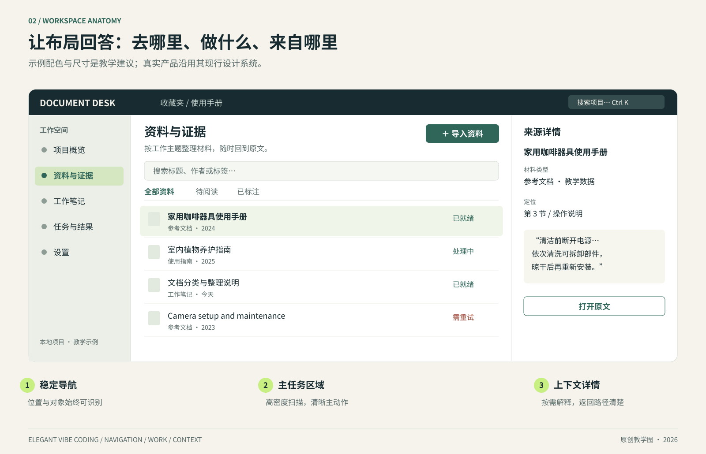

# 实战：给一个桌面笔记应用安排开发任务

[返回目录](../../README.md) · [快速开始](../../QUICKSTART.md)

**定位：虚构教学方案。** 假设要开发一个桌面笔记应用，提供笔记列表、编辑区、附件详情和文件导入导出。以下界面、数据和接口均用于说明任务拆分、设计表达与验收方法。

这个应用的基本目标是让用户找得到笔记、连续编辑、查看附件，并能可靠保存和导出。开发任务可以围绕这些可观察的结果展开。

## 一、先用四张地图掌握项目

| 地图 | 你需要知道什么 | 问编码模型的话 |
|---|---|---|
| 用户动作图 | 从哪里进入、做什么、结果出现在哪里 | 请画出“导入笔记→检索→编辑→导出”的用户路径，标出现有入口 |
| 代码地图 | UI、应用服务、存储与模型适配分别在哪里 | 请列出与本次功能相关的文件和调用方向，每项一句解释 |
| 数据地图 | 哪些是原始材料、编辑内容、索引、临时数据 | 请说明关闭程序后哪些数据应该保留，它们由哪个位置保存 |
| 验证地图 | 有哪些真实可执行的检查 | 请从当前脚本和测试文件确认验证方式，给出本次最小检查集合 |

地图保持一页左右，必要细节通过路径指向源文件。你要能用它决定“这次该动哪一小块”，并在后续变化时快速更新。

## 二、界面围绕当前操作组织

界面可以包含笔记列表、编辑区和附件详情。先确定当前操作，再安排辅助面板。下面是一张**虚构资料管理界面**，用于讨论布局与信息层级。



图中的三栏分别承担：**去哪里、做什么、为什么/来自哪里**。中间区域留给当前操作，右侧详情根据选中内容变化。三栏只是适合桌面宽屏的一种方案；窄屏可以将详情变为可关闭的抽屉，保留当前选择和返回路径。

### 怎样提出专业的前端任务

把“像一款专业软件”拆成下面四个决定：

| 决定 | 具体要求示例 | 如何确认 |
|---|---|---|
| 视觉中心 | 当前阅读/编辑区拥有最高注意力，导航和元信息降低强调 | 第一眼能识别当前材料与主要动作 |
| 工作密度 | 列表采用紧凑行高，正文保持舒适行距，批量动作按需出现 | 常用窗口内能扫描足够条目，长标题仍能辨认 |
| 操作连续性 | 切到来源详情后保留筛选、滚动和选中项 | 关闭详情回到原位置，继续操作无需重新寻找 |
| 结果可解释 | 保存结果、任务状态和可执行的下一步可见 | 失败后知道重试哪一项；完成后能找到产物 |

设计模型应先提取项目已有的颜色、间距、图标与组件。需要改变某个基线时，说明变化解决哪个实际问题，并用同一屏幕尺寸、相同数据比较前后效果。

## 三、把“智能功能”拆成可以检查的层

如果笔记应用提供摘要功能，可以把一次请求拆成：确定选中笔记与版本、确定摘要要求、解析请求配置、执行、保存结果、标注来源。这些层各有自己的事实。

| 层 | 核对的问题 | 对应证据 |
|---|---|---|
| 用户意图 | 总结哪几份资料？面向谁？多长？ | 任务输入与选中对象 |
| 实际输入 | 送入模型的内容与版本是什么？ | 输入摘要/对象版本，必要时看可读的脱敏记录 |
| 运行配置 | 实际用了哪个模型和参数？ | 实际解析后的配置；切换有明确记录 |
| 工具执行 | 调用了什么、作用于哪个项目？ | 相关工具请求与结果标识 |
| 结果保存 | 成功意味着结果已写到哪里？ | 存储对象与重开后的读取 |
| 来源解释 | 结论指向的材料位置是否真实存在？ | 文档版本、段落/页码/定位片段 |

这是审查结构，实际实现可复用现有运行时和存储组件。为个人工具增加新框架之前，先检查项目已有能力能否承担这个职责。

### 模型能力和产品正确性分别判断

产品正确性包括“调用的就是选定模型”“失败会保留草稿”“来源能打开”。模型质量包括“摘要是否准确、重点是否合适”。前者可通过确定性检查和可复现运行观察；后者需要真实样本、评价标准与适量人工判断。

在未配置真实 API 的环境中，脚本化返回可以验证交互与持久化。界面和报告都标注演示数据；真实模型调用、用量和效果由有配置的环境另行核验。两种证据各有用处。

## 四、按用户价值切任务

| 过宽的任务 | 较合适的一个切片 | 有价值的验收 |
|---|---|---|
| 重做笔记管理 | 给已有资料补一个来源详情面板 | 从一条结果打开原文位置，返回后保留查询 |
| 重构实时同步 | 修复断线重连后重复追加内容 | 模拟一次断线，同一事件只出现一次 |
| 提升任务稳定性 | 让失败的单项导入可独立重试 | 三项中一项失败，只重试该项，已完成项保留 |
| 美化整个应用 | 统一资料列表的密度和操作层级 | 正常、空、加载、失败四种状态视觉一致 |
| 优化性能 | 降低打开长列表后的首次可交互等待 | 同一数据规模与机器，记录前后测量方法和结果 |

切片的大小以“能完整交付并审查”为尺度。一次任务可以有多个文件，也可以涉及前后端；关键是围绕一个用户结果，相关变更容易一起理解。

## 五、桌面平台与本地数据怎么验收

Web 预览能说明布局、逻辑和部分接口工作。桌面集成还涉及安装目录、中文路径、文件选择、进程退出、系统缩放和升级后数据。把这些项目放在**相关改动触及时**验证即可。

例如，这次只改资料列表颜色，主要看截图、焦点与对比度；这次改数据目录，就要演练重开与升级路径。报告中写明已经验证的操作系统与版本；目标平台特有的行为在相应环境另行检查。

可填写的验收表：

| 场景 | 期待结果 | 环境 | 实际结果 | 证据 |
|---|---|---|---|---|
| 中文文件名导入 | 名称和定位保持正确 | Windows / 版本待填 | 待验证 | — |
| 程序退出后重开 | 已完成资料与任务结果可读取 | 实际桌面版 | 待验证 | — |
| 125% 系统缩放 | 主操作完整可见，菜单可用 | Windows / 显示器待填 | 待验证 | — |

表中的“待验证”是有用的状态。它让下一位协作者知道还需做什么，也让当前交付的范围清楚。

## 六、一个适合持续使用的总指令

```text
请把本仓库当前开发规则、产品说明和设计系统作为实现依据。
本次只完成：[一个用户动作与结果]。

先用简短说明确认：
- 相关入口、数据与实际技术栈；
- 现有实现中可以直接复用的部分；
- 本次会改变的状态和持久化行为；
- 最小验证路径。

涉及多个模块时，把接口和交付顺序说清。
界面延续现有视觉基线，覆盖真实可达的状态。
完成后提供实际验证证据，区分演示运行、真实模型运行和原生桌面验收。
下一次继续所需的信息写入简短交接记录。
```

## 延伸依据

上述场景与任务拆分是本手册原创方法。有关分段推进与交接的工程实践，可读 [Anthropic：long-running agents](https://www.anthropic.com/research/effective-harnesses-for-long-running-agents)；有关桌面窗口与能力配置的背景，可读 [Tauri architecture](https://v2.tauri.app/concept/architecture/)（查阅：2026-10-21）。具体部署选择按自己的产品情境决定。
