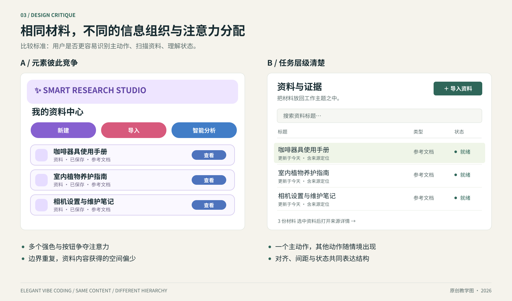
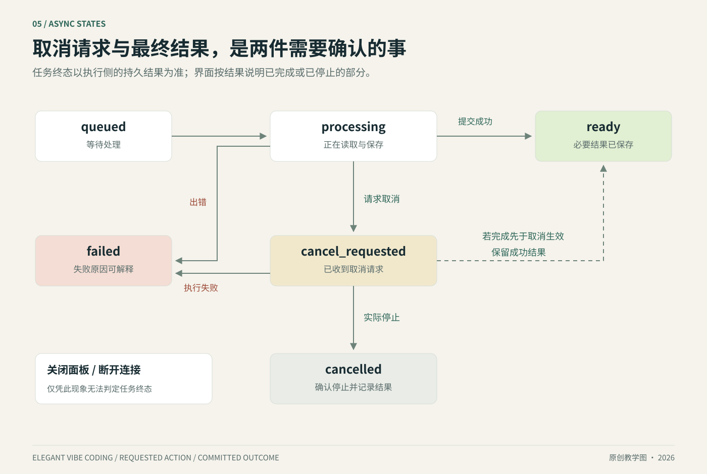
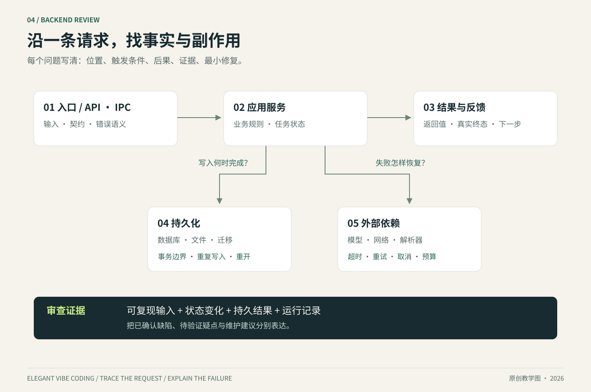

# 实战：把“资料导入”做成可以审查的功能

[返回目录](../../README.md) · [任务模板](../../templates/TASK-BRIEF.md) · [后端快速审查](../backend/02-review-in-30-minutes.md)

**这是一个完整的教学走查。** 接口名、状态名、对象结构和数据均为示意；它说明如何思考与指挥模型，不声称某个真实项目已经采用这些接口。

起始请求：“帮我做个资料导入，漂亮一点，能批量处理，失败也稳一点。”我们逐步将它转换为清楚的产品行为和检查证据。

## 1 · 写出用户实际要完成的事情

用户选择若干 TXT/Markdown 文件，查看每项导入结果，打开成功项；个别失败时可以修正后重试。关闭再打开应用，成功项仍存在。第一版只接入已有解析能力支持的格式；新增 PDF/OCR 是后续独立任务。

| 本次做什么 | 完成条件 |
|---|---|
| 选择多个文件 | 每项显示名字、状态和结果入口 |
| 防止重复提交造成重复对象 | 同一操作的重试获得同一逻辑结果；用户主动再导入的语义单独定义 |
| 显示单项失败 | 成功项保留，失败项给出原因和下一步 |
| 允许取消未完成的工作 | 明确哪些已保存、哪些已停止；最终状态来自服务端/宿主 |
| 持久保存成功项 | 重启后可以列出并打开 |

“漂亮”和“稳”在这里分别变成**信息层级**与**失败行为**。需求已经可以被验证。

## 2 · 给设计模型一份有方向的说明

```text
设计一个桌面文档管理器的资料导入面板，延续项目已有颜色、字体与组件。

视觉目标：安静、紧凑、便于连续处理资料。
结构：顶部说明允许的格式与选择入口；中部是导入项列表；底部显示结果摘要和下一步。
每行包含名称、可理解的状态、对应动作。长文件名可换行或按既有规则截断并查看完整名称。
主按钮突出“选择资料”；重试属于单项动作；已成功项可直接打开。
状态包含：尚未选择、已排队、处理中、已保存、失败、取消请求中、已取消。
失败原因在相关条目附近显示；颜色与文字共同表达状态。
键盘能完成选择、遍历与重试；状态变化不抢走焦点。

请用真实长度的中文标题和一个英文标题做视觉验收。
先实现已有组件可表达的结构，新增设计token需要说明必要性。
```

### 比较两个方案时看什么



左侧的元素彼此竞争：多个强按钮、相近字号、重复卡片边界、过多装饰色。右侧将主动作、资料内容和辅助状态分级，改用清楚的对齐与分组。**右侧更适合这个连续处理资料的任务**；它也展示了设计评价应和任务一起讨论。

## 3 · 给实现模型一个边界明确的数据契约

下面是 **TypeScript 形式的类型示意**，便于解释数据含义；字段与项目实际语言、接口和迁移方式协调后才写入代码。

```ts
type ImportState =
  | "queued"
  | "processing"
  | "cancel_requested"
  | "ready"
  | "failed"
  | "cancelled";

type ImportJob = {
  jobId: string;          // 一次后台执行的标识
  batchId: string;        // 一次多选形成的批次标识
  operationId: string;    // 每个导入项的逻辑操作标识
  inputVersion: string;   // 本次输入快照的版本或内容摘要
  projectId: string;      // 资料归属
  sourceName: string;     // 用户能识别的名称
  state: ImportState;
  materialId?: string;   // 保存成功后指向资料对象
  errorCode?: string;    // 稳定错误类型，供UI选择适当说明
  updatedAt: string;
};
```

关键问题是字段之间的关系：

- 每个导入项有自己的 `operationId`，多选形成的 `batchId` 只负责分组。同一输入快照的传输重试沿用相同操作标识，并核对 `inputVersion`。
- 修正文件内容或编码后，创建新操作；若产品支持在原任务下续做，应另行定义 attempt 与输入版本的协议。已处理请求、可重试失败与处理中请求各自怎样返回，也要写清楚。用户主动再次导入是否按内容去重，属于另一项产品语义。
- `ready` 表示原始资料与必要元信息已按项目规则保存成功；解析索引若异步完成，应另有对应状态。
- `materialId` 指向保存后的资料；它与某次导入任务的 `jobId` 分开。
- `cancel_requested` 表示已提出取消，真正停止并记录结果后才进入 `cancelled`。
- 结果中若发生部分成功，分别记录各项状态，汇总文案与明细一致。

### 一个 API/IPC 契约审查句式

```text
请先说明本次入口的输入、返回值、稳定错误类别和重复调用语义。
从前端发起动作到保存结果追一遍，指出状态以哪个服务或宿主为准。
如果当前接口已能表达这些行为，请复用；只增加完成本次任务所必需的字段。
```

## 4 · 画出会实际发生的状态变化



这张图聚焦执行中的取消，并标出取消请求与提交完成的竞争：如果成功结果已经提交，最终可以是 `ready`；界面应说明“该项已完成”。任务还在可中止阶段，停止工作并记录结果后进入 `cancelled`。尚在排队的任务也可以按协议撤队，并在确认后进入 `cancelled`。前端断开连接、关闭面板或展示“已取消”，各自只改变了一部分现象；后台终态需要被确认。

这一点也适用于模型生成、文件转换和索引任务。将“用户请求了什么”与“系统最终完成了什么”分别记录，很多难解释的状态就会变清楚。

## 5 · 后端 review：逐段追踪



| 路径 | 本次要查的问题 | 值得取得的证据 |
|---|---|---|
| 入口 | 参数在真实入口经过验证吗？ | 无效格式/缺失字段的结果 |
| 操作去重 | 两次相同请求会产生几份资料？ | 相同 `operationId` 的重复调用记录 |
| 文件读取 | 支持格式、编码和失败原因是否清楚？ | 一份合法文件、一份失败样本 |
| 保存 | 文件与数据库记录怎样保持可恢复？ | 正常保存、相关故障点的状态 |
| 取消 | 哪个阶段可停止，何时确认终态？ | 取消前后任务记录与副作用 |
| 列表更新 | UI 是从持久结果刷新还是本地猜测？ | 重新加载/重启后的列表 |

### 需要重点讨论的一种缺陷

假设实现先写 `ready` 数据库记录，再把文件复制到正式目录。复制失败时，用户可能看到一份打不开的“成功资料”。这是**可复现的正确性问题**，优先于变量命名或目录风格。

修复方案需顺应当前存储架构：例如先完成暂存与校验，按既定保存协议发布对象；失败时保留可解释状态并清理或恢复暂存。数据库事务只覆盖其数据库操作，文件系统的复制与移动需要单独考虑。[SQLite 事务文档](https://www.sqlite.org/lang_transaction.html)说明了数据库事务边界；跨资源恢复方法属于本例的工程设计选择。

一份有用的发现可以写成：

```text
优先级：P1（本手册定义；影响资料可用性）
位置：示例 import-service 的完成分支，数据库标记 ready 之后的文件复制。
触发：复制阶段发生 I/O 失败。
结果：资料列表显示完成，原始文件不存在，重新打开仍无法读取。
证据：故障注入后的数据库记录、目标目录检查与打开结果。
最小修复方向：让 ready 的发布以必要资源已保存为前提，并沿项目既有方式恢复/清理中间状态。
回归场景：模拟同一故障，确认列表显示可解释结果，且重试能完成。
```

这里的文件位置是教学描述。真实审查必须替换成实际路径和代码位置，取得证据后再写“已确认”。

## 6 · 选择足够的验证

测试应针对本次真实风险。这个功能可以采用下表作为起点，按实现增减。

| 检查 | 为什么需要 | 完成证据 |
|---|---|---|
| 正常导入并打开 | 验证核心用户路径 | 操作记录、打开内容 |
| 相同操作重复提交 | 验证幂等语义 | 逻辑对象数量及返回标识 |
| 一项失败 | 验证局部失败 | 成功项保留、失败项可重试 |
| 处理中取消 | 验证取消与终态 | 最终任务记录和已保存内容 |
| 保存后的重开 | 验证持久化 | 新进程读取同一资料 |
| 既定桌面尺寸和缩放 | 验证视觉与可达操作 | 截图与键盘操作记录 |

少量真实样本比大量仅镜像实现的断言更有解释力。真实模型、外部服务和原生系统检查由实际影响决定；本例 TXT/Markdown 导入通常可以在无付费模型的环境中完成验证。

## 7 · 交付给人的最后一页

```text
功能：[资料批量导入]
基线：[实际分支与提交]
改变：选择资料→逐项处理→显示结果→打开成功项；失败项可重试。
视觉：沿用现有tokens，补齐空白、进行中、失败与完成状态。
数据：ready的含义与持久化规则已写入对应契约。
验证：[实际命令/操作] → [结果]。
平台：[操作系统、浏览器/桌面版本、缩放]。
尚未验证：[明确项目，或“本次范围内无已知缺项”]。
后续：[一个最有价值的后续任务，如确有需要]。
```

完成这个练习后，你已经把产品说明、设计语言、数据契约、状态机、review 和验收连成一条线。下一个功能沿用同样的结构，具体内容随任务改变。

## 参考资料

- [SQLite Transactions](https://www.sqlite.org/lang_transaction.html)：数据库事务与并发语义。
- [MDN AbortController](https://developer.mozilla.org/en-US/docs/Web/API/AbortController)：浏览器一侧中止异步操作的接口背景；业务取消仍需自己的协议。
- [WAI 状态消息](https://www.w3.org/WAI/WCAG22/Understanding/status-messages.html)：状态变化的可感知性与辅助技术背景。

查阅：2026-10-21。本文整体任务设计、数据模型与审查记录为原创教学示例。
