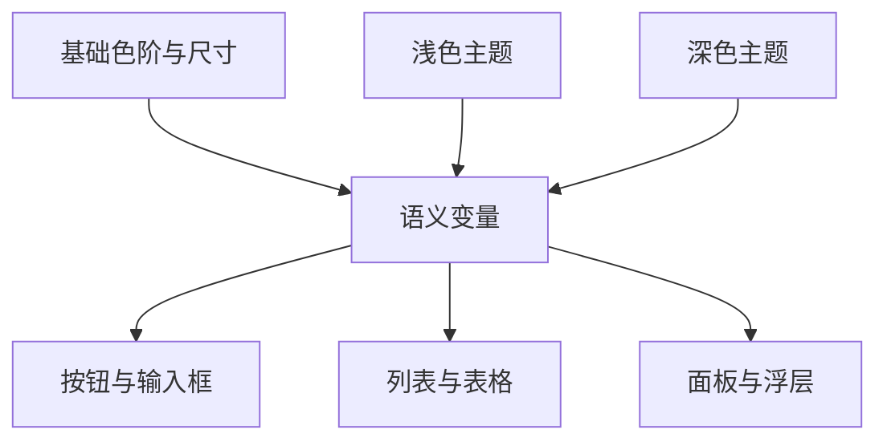

# 设计系统：让几十个页面说同一种视觉语言

[返回目录](../../README.md) · [快速开始](../../QUICKSTART.md)

> 本章提供通用结构和原创教学规格。若项目已有品牌、tokens、组件库与交互约定，应先读现有实现，再决定哪些规则值得补充。示例配色与布局是一套独立教学方案，采用时按目标产品调整。

设计系统可以从很小的一套决定开始：文字怎么分层、间距有哪些档位、颜色按什么含义命名、按钮有哪些状态、页面怎样组织。把这些决定集中起来，模型在下一次修改时就能沿用同一套规则。

一个可维护的系统通常包含**原则、设计变量、组件、组合模式和使用文档**。组件库负责代码复用；设计系统还负责说明为何选这个组件、何时采用什么状态、如何保持整体一致。

## 1. 从“色值集合”走向“有意义的角色”

可以用三层组织变量。小项目先完成前两层，组件出现真实差异后再增加第三层。

| 层次 | 示例 | 解决的问题 |
| --- | --- | --- |
| 基础值 / Primitive | `green-700: #25624e`、`space-4: 16px` | 统一原始材料 |
| 语义值 / Semantic | `action-primary`、`text-secondary`、`surface-raised` | 告诉组件“这个值用来干什么” |
| 组件值 / Component | `button-primary-bg`、`table-row-selected-bg` | 为确有需要的组件保留局部可调空间 |

主题切换主要改变语义值的映射。例如浅色主题中的主要操作可以是深绿底白字，深色主题中可以是浅绿底深字。组件仍然使用 `action-primary` 与 `on-action-primary`。这种做法表达的是用途；Atlassian 的 tokens 文档也以命名设计决定和使用角色组织样式。[Atlassian：Design tokens](https://atlassian.design/tokens/design-tokens/)



**常见沟通错误：**“把所有灰色调浅”。它可能同时影响正文、禁用态、边框、占位符和阴影。更精确的表达是：“保持正文对比度，降低常驻分隔线的视觉权重，次要文字仍满足对应背景的阅读要求。”

## 2. 一份可交给模型的设计规格

以下是虚构“资料管理工作台”的原创建议起点，既可讨论，也可转换成代码。数值服务于这个教学场景，使用前应结合已有组件和真实内容调整。

### 2.1 视觉与内容原则

| 方面 | 建议规格 | 验收方式 |
| --- | --- | --- |
| 使用目标 | 长时间阅读、检索、对照材料，追踪任务进度 | 用一份真实长文完成选材料、查来源、运行任务、看结果 |
| 视觉基调 | 中性色占大面积；单一品牌强调；成功、警告、错误有独立语义 | 灰度观看仍能判断层级；状态保留文字与形状 |
| 主次关系 | 当前对象和当前动作优先；元数据有明确去处 | 首屏能回答“我在哪、现在处理谁、下一步是什么” |
| 分组方式 | 先用位置和留白，再用边界；临时浮层才需要明显悬浮感 | 同层任务没有多层套卡片造成的重复边界 |
| 交互文案 | 动词 + 对象，如“导入材料”“重新索引”“复制引用” | 按钮脱离周围文字仍能大致理解 |
| 数据状态 | 数据来源、更新时间、是否为演示数据可识别 | 截图中能区分真实结果与教学内容 |

### 2.2 规格表

| 类别 | 默认建议 | 说明 |
| --- | --- | --- |
| 间距 | 4、8、12、16、24、32、48px | 允许光学校正，但主要关系落在统一尺度上 |
| 字号 | 辅助 13px、控件 14–15px、长文 16px、分节 18px、页标题 24px | 以实际中英混排与缩放检查为准 |
| 行高 | 控件约 1.4，列表约 1.5，长文约 1.7 | 让阅读与操作使用不同节奏 |
| 字重 | 400、500/600、700 | 先确认目标字体确有对应字重，避免伪粗体观感 |
| 圆角 | 输入和按钮 6px，面板 10px，徽标按内容决定 | 限制档位，比到处单独微调更易维护 |
| 控件高度 | 标准 40px，紧凑 32px | 这是产品建议；WCAG 最小目标规则见下一章 |
| 表格行高 | 标准约 44px，紧凑约 36px | 多行内容自然长高，减少硬裁切 |
| 正文宽度 | 先按约 30–45 个汉字的实际行长试排 | 依字体和窗口调整，不将字符数当强制尺寸 |
| 层级 | 基底、常驻表面、浮层三种 | z-index 用命名层级约束，避免随手写极大数 |
| 动效时长 | 小状态 120–160ms，面板 180–240ms | 原创建议；按任务与 reduced motion 调整 |

Carbon 将间距作为可命名、可复用的尺度，用于组件内部和布局之间；本章借鉴的是组织思路，具体尺度和命名由教学方案自行选择。[Carbon：Spacing](https://www.carbondesignsystem.com/building-blocks/foundations/spacing/overview)

### 2.3 颜色角色

| 语义 token | 浅色示例 | 深色示例 | 用途 |
| --- | --- | --- | --- |
| `canvas` | `#f6f4ef` | `#141b18` | 全局基底 |
| `surface` | `#ffffff` | `#1c2621` | 主要内容表面 |
| `surface-muted` | `#eeeee9` | `#26322b` | 次级区域 |
| `text-primary` | `#202a29` | `#edf2ed` | 主体文字 |
| `text-secondary` | `#52605b` | `#b8c6bd` | 元数据与说明 |
| `action-primary` | `#25624e` | `#9fd3b7` | 主要动作背景 |
| `on-action-primary` | `#ffffff` | `#13281d` | 主要动作上的文字 |
| `border-subtle` | `#d6dbd3` | `#42554a` | 装饰性分隔线 |
| `border-control` | `#77867d` | `#7b9182` | 需要辨识的控件边界 |
| `focus` | `#246bce` | `#8bbcff` | 键盘焦点 |

边界的用途很重要。用于轻分组的分隔线可以柔和；承担识别控件或必要状态的视觉信息，需要满足适用的非文本对比要求。应测量实际相邻色和最终渲染状态，透明度、覆盖层和渐变都可能改变结果。[WAI：Non-text Contrast](https://www.w3.org/WAI/WCAG22/Understanding/non-text-contrast.html)

## 3. 可执行的 CSS 起点

完整可交互教学示例位于 [index.html](../../examples/frontend-lab/index.html)，配套 [tokens.css](../../examples/frontend-lab/tokens.css)。下载后用浏览器打开 HTML 即可；它提供主题切换、密度切换、过滤、模拟任务与对话框，所有数据都是演示数据，不连接服务。

下面是同一思路的最小版本：

```css
:root {
  color-scheme: light;
  --canvas: #f6f4ef;
  --surface: #fff;
  --text-primary: #202a29;
  --text-secondary: #52605b;
  --action-primary: #25624e;
  --on-action-primary: #fff;
  --border-control: #77867d;
  --focus: #246bce;
  --space-2: .5rem;
  --space-4: 1rem;
  --space-6: 1.5rem;
  --radius-control: .375rem;
  --control-min-height: 2.5rem;
  --control-padding-block: .5rem;
}

[data-theme="dark"] {
  color-scheme: dark;
  --canvas: #141b18;
  --surface: #1c2621;
  --text-primary: #edf2ed;
  --text-secondary: #b8c6bd;
  --action-primary: #9fd3b7;
  --on-action-primary: #13281d;
  --border-control: #7b9182;
  --focus: #8bbcff;
}

[data-density="compact"] {
  --control-min-height: 2rem;
  --control-padding-block: .25rem;
}

* { box-sizing: border-box; }
body {
  margin: 0;
  background: var(--canvas);
  color: var(--text-primary);
  font-family: system-ui, -apple-system, "Segoe UI",
    "Noto Sans SC", "Microsoft YaHei", sans-serif;
  line-height: 1.6;
}

button, input, select, textarea { font: inherit; }
.button {
  min-block-size: var(--control-min-height);
  padding: var(--control-padding-block) .875rem;
  line-height: 1.4;
  border: 1px solid var(--border-control);
  border-radius: var(--radius-control);
  color: var(--text-primary);
  background: var(--surface);
}
.button--primary {
  background: var(--action-primary);
  color: var(--on-action-primary);
  border-color: var(--action-primary);
}
:focus-visible { outline: 3px solid var(--focus); outline-offset: 3px; }
.panel { min-inline-size: 0; padding: var(--space-6); background: var(--surface); }
.prose { max-inline-size: 68ch; line-height: 1.75; overflow-wrap: anywhere; }
.number { font-variant-numeric: tabular-nums; }

@media (prefers-reduced-motion: no-preference) {
  .button { transition: background-color 140ms ease, border-color 140ms ease; }
}
```

CSS 自定义属性通过 `var()` 在属性值中复用，并遵循层叠与继承。这适合表达主题和组件变量。普通自定义属性不能直接代入媒体查询的条件，如 `@media (width < var(--breakpoint))`；断点需按所用工具链单独管理。[MDN：Using CSS custom properties](https://developer.mozilla.org/en-US/docs/Web/CSS/Guides/Cascading_variables/Using_custom_properties)

**这段 CSS 的边界：**它建立变量与少量基础样式，完整组件仍需补上标签、状态、键盘行为、错误处理和真实业务接线。`68ch` 是演示宽度，应在真实中文段落中检查。HTML 教学样例展示完整一点的状态和语义，但仍需在产品目标浏览器与辅助技术中验证。

## 4. 组件契约：把“长什么样”与“怎样工作”一起写

组件规格只给默认外观，模型很容易交付一张漂亮静态图。更完整的组件契约包括输入数据、交互、状态、可访问名称、边界条件与验证。

### 示例：材料条目 MaterialRow

| 字段 | 规格 |
| --- | --- |
| 用途 | 用户选择材料并查看处理状态 |
| 输入 | 稳定 ID、标题、文件类型、来源、状态、更新时间；可选进度 |
| 默认外观 | 标题优先；来源和时间次级；状态采用图标加文本 |
| 选中 | 当前条目有持久背景或边线；焦点环单独显示 |
| 主要动作 | 选择后更新详情区；保留列表过滤条件与滚动位置 |
| 次要动作 | 明确的更多操作入口；键盘可到达 |
| 加载 | 列表首次加载有占位；局部更新保留已有内容 |
| 错误 | 指明哪个材料失败，可重试或查看可理解的详情 |
| 长标题 | 两行或可访问的截断方式；布局按内容自然长高 |
| 空来源 | 明确“来源待补充”，与读取失败区分 |
| 验证 | 30 字中文标题、80 字英文标题、无来源、重复名、错误、焦点、窄容器 |

**变体（variant）、状态（state）、尺寸（size）分开命名。**“主要/次要/危险”描述用途，“默认/悬停/禁用/忙碌”描述当前状态，“紧凑/标准”描述密度。把这些维度混成 `blueSmallLoadingButton` 会使复用与审查越来越困难。

## 5. 响应式：说明内容怎样移动

断点的意义是触发新的布局策略。只给“适配手机”容易让模型机械压缩内容。请说明哪些内容优先保留、哪些收进面板、哪些允许横向滚动，以及焦点怎样继续。

| 空间情境 | 教学方案 | 需要检查 |
| --- | --- | --- |
| 宽桌面 | 导航 + 阅读面 + 属性栏 | 阅读行长、侧栏宽度、主要动作可见性 |
| 中等窗口 | 导航收窄，属性改为按需面板 | 核心信息仍可获取，按钮文案完整 |
| 狭窄窗口 | 单主面板，导航与详情明确切换 | 焦点可预测，返回后恢复位置 |
| 狭窄局部容器 | 条目元数据换行，次要操作收拢 | 整个窗口很宽时，局部组件仍可使用 |
| 大字号 / 放大 | 允许行高、卡片和表单自然长高 | 内容与功能保留，主要阅读顺序持续清楚 |

对于可调整宽度的工作站侧栏，可在支持的环境中使用容器查询：

```css
.materials-pane { container: materials / inline-size; }
.material-meta { display: flex; gap: .75rem; }

@container materials (max-width: 24rem) {
  .material-meta { flex-direction: column; gap: .25rem; }
}
```

这里查询的是 `.materials-pane` 的宽度，样式作用于其后代。窗口宽度与局部面板宽度分别处理，更贴近多栏桌面应用的实际变化。[MDN：Container queries](https://developer.mozilla.org/en-US/docs/Web/CSS/Guides/Containment/Container_queries)

## 6. 暗色、密度与字体缩放：三个独立维度

暗色主题改变前景和背景的关系；密度调整空间利用；字体缩放照顾阅读需求。三者分别设计，用户才能按场景组合。例如深色 + 舒适密度 + 较大字体，和浅色 + 紧凑密度，都应保持可用。

制作暗色主题时，逐项检查文字、输入边界、菜单、图表、阴影、选中与禁用态。图表色板也需要检查在新底色上的区分度。透明浮层可能叠在多种内容上，实测最复杂背景。密度切换主要改变留白、行高和部分控件高度，阅读正文不必同步变小。

```text
请基于当前设计系统新增深色主题与紧凑密度。
先列出已有语义 tokens 和组件状态，再补齐缺失映射。
主题与密度分别控制，保持正文缩放可用。
验证代表性页面在浅/深 × 舒适/紧凑的四种组合。
补充加载、错误、选中、菜单、对话框和键盘焦点的截图。
报告实际对比度与发现的布局问题，逐项说明修复。
```

## 7. 设计说明应当回答什么

一份有价值的说明，可以只有五段：

1. **任务依据：**这个界面支持谁做什么，哪里最需要注意力。
2. **结构依据：**为何分栏、为何使用列表、细节为何放到侧栏。
3. **视觉依据：**字号、空间、颜色各承担哪种层级。
4. **交互依据：**等待、失败、取消、重试和键盘如何处理。
5. **验证依据：**在什么数据、宽度、主题、输入方式下看过结果，剩下什么风险。

“采用现代简约设计，提升用户体验”几乎没有可审查信息。可以换成：“将来源和更新时间放到次级行，使标题在列表中更易扫描；当前选中项保持稳定底色；每行独立提供处理失败的文字原因和重试入口。”

## 8. 可复制的系统化改造指令

```text
目标：把现有界面的零散样式整理为最小可维护设计系统。

先读取当前设计说明、tokens、组件目录及代表性页面。
列出现有规则和重复差异，并区分有意差异与偶然差异。
选择一个高频场景作为样板：材料列表 + 阅读面 + 状态区。

本轮产物：
1. 颜色、排版、间距、圆角、层级、动效的语义 tokens。
2. 按钮、输入、标签、材料条目和弹层的状态矩阵。
3. 一个基于现有技术栈的代表性实现。
4. 一页说明：规则、取舍、实例、验收结果与后续迁移顺序。

对旧组件逐步替换；保持实际业务字段、路由和服务契约。
每个视觉修改说明解决的具体问题。
先展示样板页与验证证据，再按批准范围推广到其余页面。
```

继续阅读：[设计语言](01-visual-language.md) · [交互与无障碍](03-interaction-accessibility.md) · [设计评审](04-design-critique.md)

## 原始来源

查阅日期：2026-10-21。数值方案、颜色、组件契约和代码是本手册原创示例。

- [Atlassian — Design tokens](https://atlassian.design/tokens/design-tokens/)
- [Carbon — Spacing](https://www.carbondesignsystem.com/building-blocks/foundations/spacing/overview)
- [MDN — Using CSS custom properties](https://developer.mozilla.org/en-US/docs/Web/CSS/Guides/Cascading_variables/Using_custom_properties)
- [MDN — CSS container queries](https://developer.mozilla.org/en-US/docs/Web/CSS/Guides/Containment/Container_queries)
- [WAI — Non-text Contrast](https://www.w3.org/WAI/WCAG22/Understanding/non-text-contrast.html)
