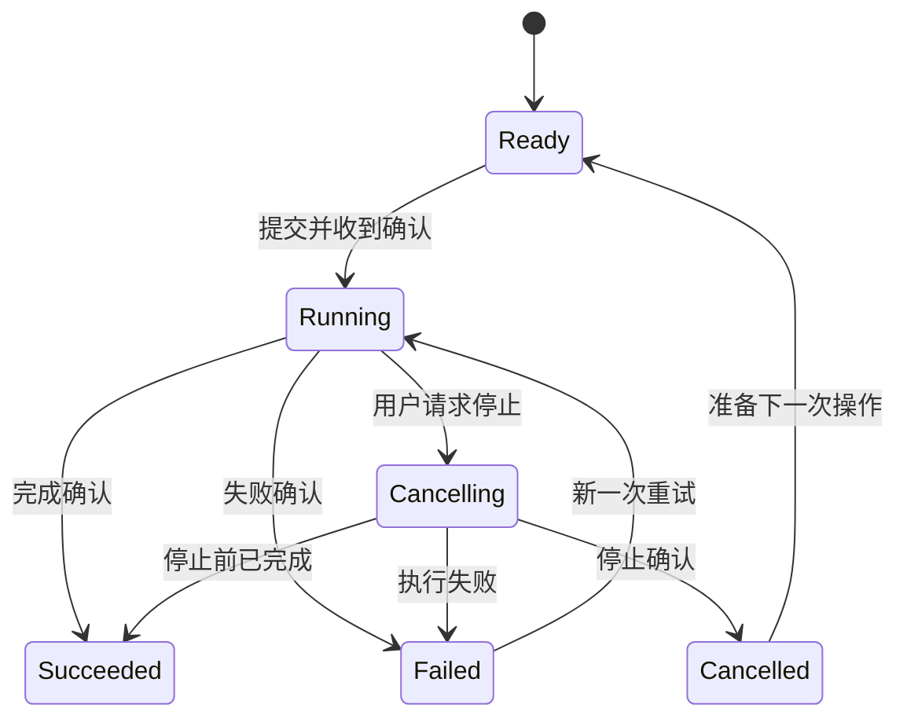

# 交互与无障碍：让界面在等待、失败和键盘操作时仍然可靠

[返回目录](../../README.md) · [快速开始](../../QUICKSTART.md)

> 本章把“设计建议”“WCAG 2.2 的部分要求”“ARIA 组件实践”分开说明。规范要求以 [WCAG 2.2 正式文本](https://www.w3.org/TR/WCAG22/)为准；表内 Understanding 链接是 WAI 官方的非规范性解释材料。下面的清单适合开发和快速审查；完整符合性评估需要覆盖全部适用成功准则、完整页面与完整流程。

前端交付的单位应当是一个能完成的任务。例如用户导入材料后，知道系统接收了什么、目前做到哪里、失败后能怎样继续。默认状态的截图只覆盖这个任务的一小段。

## 1. 状态矩阵：设计每个页面的生命过程

| 状态 | 用户真正关心的问题 | 页面应提供什么 | 资料管理工具示例 |
| --- | --- | --- | --- |
| 初始 / Idle | 我可以做什么？ | 明确入口与准备条件 | “选择材料后开始分析” |
| 首次加载 / Initial loading | 系统是否收到操作？ | 稳定占位与简明说明 | “正在读取项目材料” |
| 局部刷新 / Refreshing | 已有内容还可靠吗？ | 保留可用旧内容，标注更新中 | 列表保持可读，状态栏显示刷新 |
| 空白 / Empty | 为什么没有内容？ | 原因与下一步 | 首次使用：导入；筛选为空：清除筛选 |
| 进行中 / Running | 正在做什么？多久？ | 真实阶段、已完成量、可用操作 | “已处理 18 / 42 份材料” |
| 部分完成 / Partial | 哪些结果可用？ | 已完成项与未完成项分别呈现 | 39 份完成，3 份需重新读取 |
| 成功 / Success | 结果在哪？接下来做什么？ | 结果入口、保存状态、下一步 | “分析完成，查看 12 条候选证据” |
| 失败 / Error | 发生了什么？我的输入还在吗？ | 清楚原因、保留输入、可行恢复 | “连接中断，草稿已保留；重新连接” |
| 取消中 / Cancelling | 停止请求是否已发送？ | 取消请求状态与仍在进行的说明 | “正在请求停止当前任务” |
| 已取消 / Cancelled | 还有什么被保存？ | 最终停止确认与部分结果说明 | “任务已停止，已完成的 18 份结果保留” |
| 数据陈旧 / Stale | 我看到的是哪一次结果？ | 时间与更新入口 | “显示昨日结果；更新状态失败” |
| 离线 / Offline | 哪些功能还能用？ | 本地可用能力与待同步项目 | “可继续阅读本地材料，联网检索暂待连接” |

这张表是通用的原创设计模板。正式实现需要与后端真实状态对应；如果服务只返回“处理中”，前端应如实显示阶段未知，避免用动画制造百分比。

### 同时存在的状态要分层

一次任务可以是“进行中”，某个材料可以是“失败”，当前浏览器连接可以是“离线”。把三种状态压进一个 `loading` 布尔值，页面容易互相覆盖。让**任务状态、单项状态、连接状态和界面状态**各有定义，展示时按用户任务组合。



上图故意保留“请求取消后，任务可能先完成”的分支。界面需要接受服务返回的最终事实，并使用运行 ID 区分本次任务与后来重试。

## 2. 流式输出：把不断增长的内容做成可阅读的结果

模型输出逐步到达时，最值得关注的是阅读位置、状态真实性和结果保存。

**滚动规则。**用户在底部阅读最新输出时可以跟随新内容；用户向上查看前文后，保留当前位置，并给“有新内容，回到底部”入口。新 token 到达时维持文本选择与复制，避免整段重建造成选区丢失。

**完成规则。**响应字节停止增长与任务成功是两种信号。等待明确结束事件或约定的协议结果，再显示“完成”；断线后可标记“连接中断，内容可能未完整”，并保留已有片段。支持恢复的系统应根据运行 ID 与序号恢复，避免把重复片段拼两次。

**播报规则。**屏幕阅读器需要获知“开始、完成、失败、有新结果”等状态；逐 token 播报会制造持续打断。可建立独立、简短的状态区域，根据阶段或合适节奏更新。WCAG 4.1.3 要求适用的状态消息能被辅助技术识别，而无需先将焦点移到消息上。[WAI：Status Messages](https://www.w3.org/WAI/WCAG22/Understanding/status-messages.html)

**内容规则。**模型文本、文献原文、网页摘录属于外部输入。纯文本优先用安全文本节点呈现；Markdown 渲染器和链接处理按项目策略限制 HTML、危险 URL 和嵌入能力。`innerHTML` 会解析输入为 HTML，属于需要谨慎处理的注入入口。[MDN：innerHTML](https://developer.mozilla.org/en-US/docs/Web/API/Element/innerHTML)

```text
请补齐流式输出的完整交互。

区分提交中、运行中、完成、失败、取消中和已取消。
只有收到对应运行的最终确认，才显示完成或停止。
用户在底部时跟随新内容；向上阅读后保持位置，并提供返回最新内容入口。
保留部分结果和可用的恢复信息，说明哪些内容已经保存。
屏幕阅读器按阶段获得简短状态，正文仍可自由浏览与选择。
用断线、重复事件、延迟结束、取消后完成四种情境验证。
```

## 3. WCAG 2.2 常用核查表

以下是常见前端问题对应的**部分成功准则**。每个数值都有适用条件；“达到某个数字”只覆盖相应要求的一部分。

| 要检查什么 | 准确理解 | 典型检查方式 |
| --- | --- | --- |
| 普通文字对比度 | AA 1.4.3 通常至少 **4.5:1**；大号文字至少 **3:1**。大字常用定义为至少 18pt，或 14pt 粗体，中文等须考虑等效大小；标志和部分附带内容存在例外。[官方解释](https://www.w3.org/WAI/WCAG22/Understanding/contrast-minimum.html) | 测前景与实际背景；不要把 4.499 四舍五入为通过 |
| 必要图形与控件信息 | AA 1.4.11 适用的控件识别信息、状态与必要图形对相邻颜色至少 **3:1**；纯装饰线与禁用控件等有不同适用条件。[官方解释](https://www.w3.org/WAI/WCAG22/Understanding/non-text-contrast.html) | 看输入边界、复选标记、必要图标和焦点提示 |
| 点击目标 | AA 2.5.8 通常至少 **24 × 24 CSS px**；有间距、等效控件、行内内容、用户代理控件、必要呈现等例外。间距例外按以目标中心为圆心的 24px 直径圆检查，条件详见官方解释及规范正文。[官方解释](https://www.w3.org/WAI/WCAG22/Understanding/target-size-minimum.html) | 测可点击区域，不只测图标绘图面积 |
| 键盘操作 | A 2.1.1 要求内容功能可通过键盘接口操作，路径依赖的底层功能有例外。[官方解释](https://www.w3.org/WAI/WCAG22/Understanding/keyboard.html) | 用键盘走完整流程，包括菜单、拖动替代、弹层和错误恢复 |
| 焦点可见 | AA 2.4.7 要有可见键盘焦点提示。[官方解释](https://www.w3.org/WAI/WCAG22/Understanding/focus-visible.html) | 逐个 Tab，确认位置始终可识别 |
| 焦点遮挡 | AA 2.4.11 要求获得焦点的组件没有被作者创建的内容**完全遮住**；完全无遮挡是更强要求。[官方解释](https://www.w3.org/WAI/WCAG22/Understanding/focus-not-obscured-minimum.html) | 看固定顶栏、底栏、非模态面板与提示条 |
| 文字放大 | AA 1.4.4 要求适用文本可放大到 **200%**，保持内容与功能；字幕和图像文字有例外。[官方解释](https://www.w3.org/WAI/WCAG22/Understanding/resize-text.html) | 放大页面或文字，检查按钮、表单、弹层和错误说明 |
| 内容重排 | AA 1.4.10 对竖向滚动内容，通常检查等效 **320 CSS px** 宽度下的重排；确需二维布局的部分可例外，如数据表、地图。[官方解释](https://www.w3.org/WAI/WCAG22/Understanding/reflow.html) | 一般文字保持单方向阅读；表格局部滚动并保留上下文 |
| 拖动替代 | AA 2.5.7 要有单指针、无需拖动的等效方式，必要拖动等情形有例外；键盘替代与它是分别需要考虑的要求。[官方解释](https://www.w3.org/WAI/WCAG22/Understanding/dragging-movements.html) | 排序提供上移/下移、选择目标位置等操作 |
| 悬停提示 | AA 1.4.13 适用的附加内容应可关闭、可将指针移入并维持可见，存在具体例外。[官方解释](https://www.w3.org/WAI/WCAG22/Understanding/content-on-hover-or-focus.html) | 用鼠标和键盘打开，移动到提示内容，再尝试关闭 |

**两条容易记错的边界：**24px 是 WCAG 2.2 AA 的目标尺寸基准之一，不代表“所有按钮只能做这么大”，也不等于物理屏幕像素。手册的 32–40px 桌面控件建议属于产品设计取舍。焦点环可以采用清楚的 3px 轮廓作为实现起点，但 WCAG 2.2 对焦点外观面积的更严格条款 2.4.13 属于 AAA；不要把这条误写成 AA。[WAI：Focus Appearance](https://www.w3.org/WAI/WCAG22/Understanding/focus-appearance.html)

还有一项非常实用：AA 1.4.12 检查用户调整文字间距后内容和功能是否保留。其测试条件包含行高 1.5 倍字号、段后间距 2 倍字号、字距 0.12 倍字号、词距 0.16 倍字号，并按语言书写习惯适用。这要求的是**能适应用户调整**，产品默认排版可采用其他值。[WAI：Text Spacing](https://www.w3.org/WAI/WCAG22/Understanding/text-spacing.html)

## 4. 键盘与焦点：一套可以手动走的规则

优先使用原生按钮、链接、输入框和选择控件。它们已有基础语义与键盘行为；自定义复合组件需要主动实现对应交互。给一个 `div` 加 `role="button"` 只表达角色，仍需补上激活、焦点与状态等行为。[WAI APG：Keyboard Interface](https://www.w3.org/WAI/ARIA/apg/practices/keyboard-interface/)

### 普通页面

Tab 顺序与阅读和任务顺序相呼应。焦点可见、可预测，发生删除或切换后仍落在有意义的位置。图标按钮有可访问名称；名称表达动作，例如“展开来源详情”，而非只说“箭头”。鼠标悬停时出现的关键功能，键盘聚焦时也有可达方式。

**焦点与选中是两个维度。**焦点表示下一次键盘操作会作用于谁；选中表示当前材料、标签页或对象。两者可以暂时位于不同元素，视觉上应能区分。键盘导航时，浏览焦点就触发高成本请求，通常会降低效率；明确激活动作更可控。

### 标签页

标准标签页模式通常用 Tab 进入当前标签，用方向键在标签间移动；手动激活模式使用 Enter 或 Space 显示面板。若显示内容有明显加载延迟，手动激活更适合让用户自由浏览标签。普通导航链接与 ARIA tabs 的职责不同，应根据组件真实行为选择语义。[WAI APG：Tabs](https://www.w3.org/WAI/ARIA/apg/patterns/tabs/)

### 模态对话框

打开时把焦点放到合适的内部对象，Tab 范围留在模态框内；背景暂时不可交互；提供清楚的关闭入口，通常支持 Escape。关闭后将焦点返回触发位置，或放到更符合后续任务的对象。复杂内容可以先聚焦标题，重要不可逆操作可以先聚焦更稳妥的动作。[WAI APG：Dialog](https://www.w3.org/WAI/ARIA/apg/patterns/dialog-modal/)

原生 `<dialog>` 可以作为实现起点，`showModal()` 与普通展示的行为不同。仍要给标题、关闭入口和初始焦点做有意识的设计，并在实际目标环境中验证。[MDN：dialog](https://developer.mozilla.org/en-US/docs/Web/HTML/Reference/Elements/dialog)

## 5. 表单、错误与恢复

表单的标签应在输入后仍能看见。占位文字适合举例，真实标签负责说明字段意义。错误信息放在相关字段附近，说明哪里需要修改、允许什么格式，并保持已经填写的其他内容。

| 含糊文案 | 更有用的写法 | 为什么 |
| --- | --- | --- |
| 操作失败 | “文件读取失败，请检查文件是否仍在原位置” | 给用户一个可执行动作 |
| 参数错误 | “请填写 1–20 之间的批量数量” | 说明有效范围 |
| 系统异常 | “模型连接超时，已保留输入，可以重试” | 解释影响和恢复路径 |
| 没有数据 | “当前筛选下没有材料，清除筛选可查看全部” | 区分数据缺失与过滤结果 |
| 已取消 | “已发送停止请求，等待当前任务确认” | 在取消尚未确认时保持真实 |

这些文案是模板，前提必须由系统状态支持。“已保留”“可恢复”“不会重复扣费”等承诺，需要对应真实实现和证据。

忙碌状态也要让人知道发生了什么。如果按钮暂时不可用，附近解释正在等待什么；必要时保留可聚焦入口来读取原因。错误详情可以渐进展开，把用户可行动的信息留在第一层，把诊断信息留给需要它的人。

## 6. 十分钟交互检查

1. **一分钟看入口：**首次进入，能识别当前对象、主要动作和状态。
2. **两分钟走键盘：**Tab、Shift+Tab、Enter、Space、方向键、Escape，走完一条真实任务路径。
3. **两分钟打断操作：**提交后取消、模拟失败、再次重试；确认输入和部分结果如何保留。
4. **两分钟检查内容极端：**长标题、大段中文、英文路径、空内容和大量条目。
5. **两分钟换呈现条件：**浅色/深色、窄窗口、200% 缩放、减少动态效果。
6. **一分钟记录证据：**环境、步骤、预期、实际、受影响用户、截图或录屏。

这是快速发现问题的时间盒，发现具体风险后再做针对性验证。自动检查能够发现部分语义、对比和结构问题；读者的任务理解、焦点是否自然、错误能否恢复，仍需要实际走流程。

## 7. 交互审查提示词

```text
请审查这次前端改动的交互完整性，先阅读需求和实际diff。

重点路径：导入材料 → 选择材料 → 开始分析 → 阅读结果 → 查看来源。
覆盖默认、空白、加载、失败、重试、取消、部分成功和断线恢复。
检查焦点顺序、可访问名称、键盘激活、弹层关闭和焦点返回。
逐项核对适用的WCAG 2.2要求，区分标准要求与产品建议。

每个问题给出：严重程度、具体路径/组件、复现步骤、实际影响、最小修复。
对未执行的检查标为待验证；截图推断与实测结果分开写。
优先报告阻断任务、状态误导、内容丢失和键盘无法完成的情况。
最后给一条建议的最短回归路径。
```

继续阅读：[设计语言](01-visual-language.md) · [设计系统](02-design-system.md) · [设计评审](04-design-critique.md)

## 原始来源

查阅日期：2026-10-21。规范采用 W3C/WAI 原始资料，各表行链接到对应准则的官方解释；交互方案与提示词为原创整理。

- [WCAG 2.2 规范](https://www.w3.org/TR/WCAG22/)
- [WAI：对比度](https://www.w3.org/WAI/WCAG22/Understanding/contrast-minimum.html)、[非文本对比](https://www.w3.org/WAI/WCAG22/Understanding/non-text-contrast.html)、[目标尺寸](https://www.w3.org/WAI/WCAG22/Understanding/target-size-minimum.html)
- [WAI：键盘](https://www.w3.org/WAI/WCAG22/Understanding/keyboard.html)、[焦点可见](https://www.w3.org/WAI/WCAG22/Understanding/focus-visible.html)、[焦点遮挡](https://www.w3.org/WAI/WCAG22/Understanding/focus-not-obscured-minimum.html)、[焦点外观](https://www.w3.org/WAI/WCAG22/Understanding/focus-appearance.html)
- [WAI：文字放大](https://www.w3.org/WAI/WCAG22/Understanding/resize-text.html)、[重排](https://www.w3.org/WAI/WCAG22/Understanding/reflow.html)、[文字间距](https://www.w3.org/WAI/WCAG22/Understanding/text-spacing.html)
- [WAI：拖动替代](https://www.w3.org/WAI/WCAG22/Understanding/dragging-movements.html)、[悬停内容](https://www.w3.org/WAI/WCAG22/Understanding/content-on-hover-or-focus.html)、[状态消息](https://www.w3.org/WAI/WCAG22/Understanding/status-messages.html)
- [APG：键盘界面](https://www.w3.org/WAI/ARIA/apg/practices/keyboard-interface/)、[Tabs](https://www.w3.org/WAI/ARIA/apg/patterns/tabs/)、[Dialog](https://www.w3.org/WAI/ARIA/apg/patterns/dialog-modal/)
- [MDN：dialog](https://developer.mozilla.org/en-US/docs/Web/HTML/Reference/Elements/dialog)、[innerHTML](https://developer.mozilla.org/en-US/docs/Web/API/Element/innerHTML)
